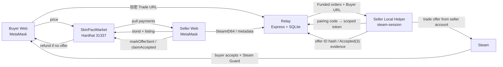

# SkinPact

一个面向 CS2 饰品的 DApp 课程项目原型：用 **测试 ETH** 托管交易款，用 **Steam trade offer** 交付饰品，绕开第三方平台手续费，同时不把 Steam 登录态或买家 Trade URL 交给平台托管。

> **S1 只允许本地 Hardhat 链（chainId 31337）。**
> 当前合约没有争议、仲裁、卖家取消和 `OfferSent` 后超时退款，**绝对不能部署到 Sepolia 或其他公开网络**。S2 补齐这些路径后才考虑 testnet。

## 当前状态

| 部分 | 状态 |
|---|---|
| `SkinPactMarket` S1 合约 + 状态机 | ✅ 本地部署可用，20 个测试通过 |
| 共享 TypeScript 包（哈希 / ABI / Trade URL 解析） | ✅ 1 个测试通过 |
| Relay（钱包登录 / 库存 / 加密 Buyer URL vault / helper 配对 / 证据） | ✅ 10 个测试通过 |
| 卖家本地 helper（Steam 登录态、发 offer、观测 Accepted、本地账本） | ✅ 8 个单元测试通过；S1 真实 Steam 流程待手动执行 |
| React Web（Market / Sell / Trade Room / withdraw） | ✅ 构建通过；手动 UI 走查待 review |
| 本地链 P1–P4 E2E（合约 + Relay） | ✅ `npm run e2e:local` 通过；Steam 传输为明确标注的 mock |
| Stage 0 真实 Steam offer | ✅ 已完成（见 Stage 0 spec）；S1 helper 尚未用真实账号复测 |

真实 Steam 交付需要卖家扫码登录自己的 Steam 账号并由买家在手机 Steam Guard 中接受，不能由自动化测试代替，也不应伪造。

## 架构



- **Relay 不托管资金或饰品，也不保存 Steam session。**
- **Helper 不接收卖家钱包私钥，不自动签链上交易，不替买家接受 offer。**
- **Buyer Trade URL 是 bearer secret**：Relay 用 AES-256-GCM 加密保存，只在链上 `Funded` 后向该 listing 的卖家/helper 揭示；API 不记录请求体/URL，listing 终态后删除。Web 的卖家界面不展示 URL。

## 快速开始（本地）

前置：Node.js ≥ 20、npm、MetaMask 浏览器扩展。真实 Steam 手动测试另需两个启用 Steam Guard Mobile Authenticator > 7 天的测试账号。

```bash
npm install
cp .env.example .env

# 生成并填入 .env 的两个 Relay 密钥
openssl rand -hex 32     # JWT_SECRET
openssl rand -base64 32  # RELAY_ENCRYPTION_KEY
```

`npm run chain/deploy:local/relay/helper` 都会显式读取**仓库根目录**的 `.env`（即使 npm workspace 把 cwd 切到了子目录），不需要把 `.env` 复制到 `relay/` 或 `helper/`。

打开三个终端：

```bash
# 1) 本地链
npm run chain

# 2) 部署（会写出 deployments/local.json，gitignored）
npm run deploy:local

# 把 deployments/local.json 里的 address 填入 .env 的 CONTRACT_ADDRESS
# 然后启动 Relay
npm run relay
```

```bash
# 3) Web
npm run web
# http://localhost:5173
```

MetaMask 添加本地网络：

- RPC URL: `http://127.0.0.1:8545`
- Chain ID: `31337`
- Currency: ETH

从 `npm run chain` 的输出导入两个 **Hardhat 测试账户**，分别作为 seller 和 buyer。这些私钥是公开的开发助记词，**只能用于本地链，绝不能用于真实资金**。

### 卖家本地 helper

1. 在 Web 的 Sell 页绑定卖家 SteamID64，选物品、定价并创建 Listing。
2. 在 Sell 页生成一次性 6 位配对码。
3. 在第四个终端运行并扫码登录卖家 Steam：

```bash
npm run helper -- --pair 123456
```

helper 会把 helper token、Steam refresh token 和本地发送账本写入 `helper/.skinpact-helper/`（600 权限、gitignored），**不会**把 Steam session 发给 Relay，也不会存 Buyer Trade URL。

`npm run helper -- --check` 只检查本地状态，不登录 Steam、不发 offer；`--once` 只跑一轮轮询。

## 最小交易流程

1. **卖家挂牌**：Web 绑定 SteamID64 → Relay 读取公开库存并生成 `itemHash` → web 调 `createListing(itemHash, price)` 并锁定 bond。
2. **买家提交 Trade URL**：只在 `Active` / `Funded` 显示输入框；Relay 加密保存，前端提交后清空输入。
3. **买家付款**：`buy(listingId)` 精确支付 price，listing 进入 `Funded`，offer deadline 开始。
4. **helper 发 offer**：卖家 helper 拉取该卖家的 `Funded` 订单，校验 buyer SteamID/物品，从卖家 Steam 登录态创建 offer，并向 Relay 上报 offer ID hash。
5. **卖家 mark**：卖家在 Trade Room 看到 helper 上报的 hash 后签 `markOfferSent`。**此动作不放款**，只是链上声明。`OfferSent` 之前买家不要接受 Steam offer。
6. 交付完成后，三条路径之一：
   - **Buyer confirm**：买家勾选“已收到物品”并调 `confirmReceipt`，立即 `Completed`，seller withdrawable += price + bond。
   - **Seller claim**：helper 观测到 Steam `Accepted(3)` 并上报证据；卖家调 `claimAccepted(evidenceHash)` 进入 `ClaimPending`；挑战窗口结束后任何人可 `finalizeClaim`。
   - **No offer**：若卖家在 offer window 内未 mark，截止后任何人可 `expireOrder`，buyer price 与 seller bond 分别进入 pull payment。
7. 在 Header 查看 withdrawable 并主动 `withdraw()`。

`OfferSent` 后买家不确认、卖家不 claim 的场景在 S1 会锁住资金；S1 不做争议或超时退款，只用于本地受控演示。

### 真实 Steam 手动验收（待执行）

1. 用两个自己的测试账号：卖家在 helper 扫码，买家手机 Steam Guard 可用。
2. 使用低价值、自己拥有的物品；买家库存需可交易。
3. 买家付款且 URL 已提交 → 启动 helper → 确认 helper 只发目标物品。
4. **等卖家在 Web 完成 `markOfferSent` 后**，买家再接受 Steam offer。
5. helper 观测到 `Accepted(3)` 后在 Relay 写入证据，卖家 claim；或买家直接确认收货。
6. 录屏/截图中遮挡 Steam 个人信息、Trade URL token、钱包私钥和 session。

如果真实链路阻塞，S1 的 E2E 使用**明确标注的 mock**（不接触 Steam），不能把 mock 当作真实 Accept 证据。

## 测试与验证

```bash
npm test          # shared + contract + relay + helper
npm run e2e:local # P1 buyer confirm / P2 claim+finalize / P3 expire / P4 privacy
npm run typecheck # shared + relay + helper + web + E2E scripts
npm run build     # Web TypeScript + Vite build
```

E2E 会启动一个临时的 Hardhat 节点、部署合约、以内存 SQLite 启动真实 Relay，并覆盖：

- P1：create → buy → 加密 URL → mock helper offer → mark → buyer confirm → Completed；seller withdrawable = price + bond。
- P2：claim → ClaimPending → 窗口前 finalize revert → 时间推进 → permissionless finalize。
- P3：不 mark → 超时 expire → Refunded；buyer price、seller bond 退回 pull payment；`OfferSent` 不可 expire。
- P4：未 Funded/错误 seller/错误 scope 拒绝 reveal；DB、metadata、report 无 URL token；终态清理。

## 环境变量

见 [`.env.example`](./.env.example)。关键项：

| 变量 | 说明 |
|---|---|
| `CONTRACT_ADDRESS` | 本地部署地址；复制自 `deployments/local.json` |
| `JWT_SECRET` | Relay 钱包登录 JWT；≥ 16 字符 |
| `RELAY_ENCRYPTION_KEY` | AES-256-GCM 密钥；32 bytes，base64 或 64 hex |
| `DB_PATH` | SQLite 路径，默认 `data/skinpact.db`（gitignored） |
| `SKINPACT_RELAY_URL` | helper 访问 Relay 的地址；非本地地址必须 HTTPS |
| `SKINPACT_HELPER_DIR` | helper 本地状态目录，默认 `helper/.skinpact-helper` |

Web 的 Vite 默认读取 `deployments/local.json` 与本地默认地址，通常无需额外 env。

## S1 安全边界与已知限制

- 只支持本地链和测试 ETH；不允许真实货币、贵重饰品或公开网络。
- Buyer Trade URL 是私密 bearer URL：链上永不保存，Web 卖家 UI 不展示，Relay 加密保存并在终态删除；日志不打印 URL/请求体。
- 没有 `Disputed`、Arbiter、`openDispute`/`resolveDispute`、`abortBySeller`、卖家取消。
- `OfferSent` 后买家一直不接受且卖家不 claim 时，资金会锁在合约中；S1 不退款。
- 卖家在 `markOfferSent` 之前买家可以接受 Steam offer，会造成链上状态与事实不一致；流程和 UI 强调“先 mark 再接受”，S1 只用受控账号。
- 卖家可以 mark 但实际上不发 offer；S1 无链上仲裁，只用于本地 demo。
- `claimAccepted` 证据是链下声明；S2 才补挑战/仲裁与更严格的证据策略。
- 结算使用 pull payment：双方必须主动 `withdraw()`。
- helper 不自动确认 Steam Mobile Guard，不自动签链、不自动提现、不替买家接受。

## 仓库结构

```
contracts/       Solidity + Hardhat tests + local deploy
shared/          ABI、canonical JSON/keccak、hash、Trade URL parser
relay/           Express + SQLite，钱包登录、inventory、URL vault、helper API
helper/          卖家本地 Node helper（steam-session + trade offer manager）
web/             React + Vite + ethers v6
scripts/stage0/  Stage 0 可行性演示（只作参考，不复用于 S1）
scripts/         local E2E
specs/           MVP / Stage 0 / Stage 1 review specs
```

相关 spec：

- [MVP spec](./specs/2026-11-01-dapp-project-mvp-spec.md)
- [Stage 0 Steam feasibility](./specs/2026-11-02-stage-0-steam-tradeoffer-spec.md)
- [Stage 1 vertical slice](./specs/2026-11-03-stage-1-vertical-slice-spec.md)

## 常见问题

- **Web 显示“本地合约未配置”**：先 `npm run chain`、`npm run deploy:local`，再重启 `npm run web`。
- **绑定 SteamID 后库存为空或 `relay_timeout`**：Relay 需要访问 `steamcommunity.com` 读取公开库存。先验证：
  ```bash
  curl -4 -I --max-time 10 https://steamcommunity.com/
  ```
  如果超时，不是库存设置问题，而是 Relay 所在网络访问不了 Steam 社区。开启系统 VPN/代理后重启 Relay；若使用本地 HTTP 代理（例如 Clash），让 Relay 走代理：
  ```bash
  HTTPS_PROXY=http://127.0.0.1:7890 HTTP_PROXY=http://127.0.0.1:7890 \
    NO_PROXY=127.0.0.1,localhost npm run relay
  ```
  代理端口以本机实际配置为准。浏览器能打开 Steam 社区不代表 Node/Relay 也能访问。卖家 helper 也会连接 Steam Community，必须使用同样的网络/代理环境启动；最省事的是系统级 VPN。
- **Relay 启动报 RPC/合约错误**：检查本地链是否运行、`.env` 的 `CONTRACT_ADDRESS` 是否与当前 `deployments/local.json` 一致；链重启后地址会变。
- **MetaMask 交易失败/网络错误**：切到 31337；重启本地链后需要在 MetaMask 中重置账户 nonce（设置 → 高级 → 清除活动标签页数据）或重新导入。
- **helper 提示 SteamID 不一致**：Web 绑定的卖家 SteamID64 必须与 helper 扫码登录的账号一致。
- **真实 Steam offer 被暂挂**：确认两个账号 Steam Guard Mobile Authenticator 已启用 > 7 天；不要用真实贵重物品测试。
