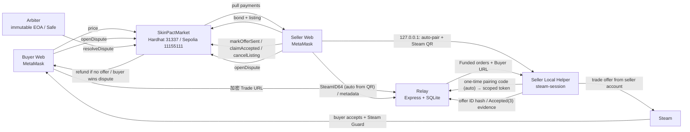

# SkinPact

一个面向 CS2 饰品的 DApp 课程项目原型：用 **测试 ETH** 托管交易款，用 **Steam trade offer** 交付饰品，绕开第三方平台手续费，同时不把 Steam 登录态或买家 Trade URL 交给平台托管。

> **S2-mini 已部署到 Sepolia（chainId 11155111），仍只使用 test ETH，禁止主网或真实价值。**
> 合约 `0x2Ffca05611801F532Afc6135b56baBEB0D7460eF`，部署 tx `0xa13facad2e103aa5df7fe0d876f73e742cb3ba4c9c9a7a037d446f52c22e04e6`，Etherscan 已 verified；更完整的仲裁策略仍是后续工作。

## 当前状态

| 部分 | 状态 |
|---|---|
| `SkinPactMarket` S2-mini 合约 + 状态机 | ✅ 本地部署可用，36 个测试通过 |
| Sepolia 部署 + verify + smoke | ✅ 合约 `0x2Ffca…460eF`，block 12077649；[Etherscan verified](https://sepolia.etherscan.io/address/0x2Ffca05611801F532Afc6135b56baBEB0D7460eF#code)；11 笔 smoke tx（Steam/Relay/helper 未参与） |
| 共享 TypeScript 包（哈希 / ABI / Trade URL 解析） | ✅ 1 个测试通过 |
| Relay（钱包登录 / 库存 / 加密 Buyer URL vault / 买家 Steam 账户 / helper 配对 / 证据） | ✅ 18 个测试通过 |
| 卖家本地 helper（Steam 登录态、发 offer、观测 Accepted、本地账本、loopback 扫码 API） | ✅ 12 个单元测试通过；Web 扫码登录/自动配对已接入；已用真实 Steam 账号跑通发 offer 与 Accepted 证据 |
| React Web（Market / Orders / Accounts / Sell / Trade Room / withdraw / cancel / dispute / resolve） | ✅ 构建通过；手动 UI 走查待 review |
| 本地链 P1–P8 E2E（合约 + Relay） | ✅ `npm run e2e:local` 通过；Steam 传输为明确标注的 mock |
| Stage 0 真实 Steam offer | ✅ 已完成（见 Stage 0 spec）；helper 已用真实账号复测 |
| E1 Gas / 费率实验 | ✅ 本地 11 操作 + Sepolia 全部 11 操作（原始 smoke + completion smoke）；CSV、图表、盈亏平衡与竞品费率来源见 [`experiments/e1/`](experiments/e1/README.md) |
| E2 安全 / 信任边界实验 | ✅ threat model、17 findings、trust table、Slither（0 High/Medium）、coverage（100% lines / 87.5% branch）见 [`experiments/e2/`](experiments/e2/README.md) |

真实 Steam 交付需要卖家扫码登录自己的 Steam 账号并由买家在手机 Steam Guard 中接受，不能由自动化测试代替，也不应伪造。

## 实验数据（E1/E2）

- **E1**：本地 Hardhat（Osaka）覆盖全部 11 个操作；Sepolia 覆盖全部 11 个操作（11-06 原始 smoke + 11-07 completion smoke）。Happy path（create + buy + mark + confirm）本地 374,508 gas、Sepolia 1,173,272 gas；在 10 gwei / $3,000 ETH 假设下，Sepolia gas ≈ $35.20，1%/2.5%/5% 费率的盈亏平衡价分别约为 $3,520 / $1,408 / $704。
- **环境差异（必须注明）**：Sepolia 在本次 smoke 中表现出 Amsterdam 时代 gas 规则（EIP-8037/8038；EIP-7708 ETH 转账日志），本地 Hardhat 2.29.1 默认 Osaka；状态创建类操作 gas 可相差 2.6–4 倍，实验报告并列呈现，不混用。
- **E2**：36 合约测试 + 1 shared + 18 relay + 12 helper、99-check E2E 全部通过；Slither 0 High/Medium；主要残余风险是 Steam 交付不可链上验证、arbiter 单点、Relay 可解密 buyer Trade URL（均已在 E2 文档中披露）。
- **限制**：E1 的 Sepolia completion smoke 为真实发交易并等待窗口（约 10 分钟），数据为单次运行；E2E 的 Steam 传输是 mock；test ETH 无真实价值。

## 架构



- **Relay 不托管资金或饰品，也不保存 Steam session。**
- **Helper 不接收卖家钱包私钥，不自动签链上交易，不替买家接受 offer。**
- **Buyer Trade URL 是 bearer secret**：Relay 用 AES-256-GCM 加密保存，只在链上 `Funded` 后向该 listing 的卖家/helper 揭示；API 不记录请求体/URL，listing 终态后删除。Web 的卖家界面不展示 URL。

## 一键启动（Sepolia，推荐）

日常演示和手动验收统一使用 **Sepolia**，不需要启动本地 Hardhat 节点。仓库根目录的启动脚本会同时拉起 Relay 和 Web：

```bash
npm install

# 确认仓库根目录 .env 中有：
# SEPOLIA_RPC_URL / JWT_SECRET / RELAY_ENCRYPTION_KEY

npm start                 # 等价于 npm run dev:sepolia
# Web:   http://localhost:5173
# Relay: http://127.0.0.1:8787
```

脚本会自动完成这些检查与配置：

1. 从仓库根目录 `.env` 读取 `SEPOLIA_RPC_URL` 和 Relay 密钥；
2. 校验 `deployments/sepolia.json` 的 chainId 与合约地址，并通过 RPC 确认链为 `11155111`、合约地址上存在字节码；
3. 生成被 gitignore 的 `web/.env.sepolia`（权限 600），不提交 RPC URL；
4. 以 **Sepolia** 配置启动 Relay（独立数据库 `relay/data/skinpact-sepolia.db`）和 `vite --mode sepolia`；
5. 按 `Ctrl-C` 同时停止两个进程；端口被占用时会打印停止旧进程的命令。

当前 Sepolia 合约：`0x2Ffca05611801F532Afc6135b56baBEB0D7460eF`。MetaMask 需切换到 **Sepolia（11155111）**，并准备 test ETH 支付 gas 和 `0.001 ETH` 的挂牌保证金。完整卖家流程（Steam 扫码、发 offer）还需在另一个终端运行 `npm run helper`。市场暂时没有 Active 挂牌是正常的。

## 本地链开发（可选）

以下流程只用于本地链开发、合约测试和 E2E；日常演示请用上节的 `npm start`。

前置：Node.js ≥ 20、npm、MetaMask 浏览器扩展。真实 Steam 手动测试另需两个启用 Steam Guard Mobile Authenticator > 7 天的测试账号。

```bash
npm install
cp .env.example .env

# 生成并填入 .env 的两个 Relay 密钥
openssl rand -hex 32     # JWT_SECRET
openssl rand -base64 32  # RELAY_ENCRYPTION_KEY
```

`npm run chain/deploy:local/relay/helper` 都会显式读取**仓库根目录**的 `.env`（即使 npm workspace 把 cwd 切到了子目录），不需要把 `.env` 复制到 `relay/` 或 `helper/`。

打开三个终端：

```bash
# 1) 本地链
npm run chain

# 2) 部署（会写出 deployments/local.json，gitignored）
npm run deploy:local

# 把 deployments/local.json 里的 address 填入 .env 的 CONTRACT_ADDRESS
# 然后启动 Relay
npm run relay
```

```bash
# 3) Web
npm run web
# http://localhost:5173
```

MetaMask 添加本地网络：

- RPC URL: `http://127.0.0.1:8545`
- Chain ID: `31337`
- Currency: ETH

从 `npm run chain` 的输出导入两个 **Hardhat 测试账户**，分别作为 seller 和 buyer。这些私钥是公开的开发助记词，**只能用于本地链，绝不能用于真实资金**。

### 卖家本地 helper（扫码登录）

1. 另开一个终端启动 helper 并保持运行：

```bash
npm run helper
```

helper 只在 `127.0.0.1:8788` 提供本地 API，不监听公网。
2. 打开 Web 的 **Sell** 页，连接 MetaMask 并完成 Relay 钱包签名登录。页面会通过 loopback 自动把 helper 配对到当前钱包（配对码不可见，无需复制），随后显示 Steam 二维码。
3. 用**卖家账号**的 Steam 手机令牌扫码。helper 在本机保存 Steam 登录态，Web 自动绑定扫码得到的 SteamID64 并加载 CS2 库存。
4. 选择物品、定价并创建 Listing。helper 显示“已就绪”后才会允许挂牌。

helper 会把 helper token、Steam refresh token 和本地发送账本写入 `helper/.skinpact-helper/`（600 权限、gitignored），**不会**把 Steam session 发给 Relay，也不会存 Buyer Trade URL。浏览器只拿到 QR 图片与公开的 SteamID64，不能拿到 Steam token/refresh token。

`npm run helper -- --cli` 是旧的无浏览器终端流程；`--check` 只检查本地状态，不登录 Steam、不发 offer；`--once` 只跑一轮轮询（仅旧 CLI 流程）。

## Sepolia 部署（已完成）

- 合约：[0x2Ffca05611801F532Afc6135b56baBEB0D7460eF](https://sepolia.etherscan.io/address/0x2Ffca05611801F532Afc6135b56baBEB0D7460eF#code)（Etherscan verified）
- 部署 tx：`0xa13facad2e103aa5df7fe0d876f73e742cb3ba4c9c9a7a037d446f52c22e04e6`
- Block：`12077649`
- Chain：`11155111`
- Arbiter：`0xfc73C38cD376D01F9B145e78fa6968F081e66D53`
- Constructor：maxPrice `0.1 ETH` / minBond `0.001 ETH` / offerWindow `600s` / challengeWindow `300s` / deliveryWindow `3600s`
- Smoke：`experiments/e1/sepolia-smoke.json`，11 笔真实 Sepolia 交易（create → buy → mark → confirm、cancel、dispute → resolve；Steam/Relay/helper 未参与）

重新部署/验证/采数：

```bash
# 在仓库根 .env 填入：
# SEPOLIA_RPC_URL / DEPLOYER_PRIVATE_KEY / ARBITER_ADDRESS / ETHERSCAN_API_KEY
npm run preflight:sepolia # 只打印公开地址/余额与缺失项
npm run deploy:sepolia    # 部署 + 尝试 verify，写 deployments/sepolia.json
npm run smoke:sepolia     # 真实 Sepolia on-chain smoke + gas 数据
npm start                 # Web + Relay，一键进入 Sepolia 演示模式（推荐）
npm run web:sepolia       # 只启动 Web；需已有 web/.env.sepolia
```

本地链演示仍可用；Sepolia 演示统一使用 `npm start`，它会从 `deployments/sepolia.json` 和根 `.env` 自动生成 `web/.env.sepolia`。

## 最小交易流程

Market 只展示 `Active` 挂牌；**Orders** 页展示所有状态的订单，并可按当前 MetaMask 钱包筛选“只看我的”。**Accounts** 页按当前 MetaMask 钱包管理买家 Steam 账户，可在下单前先添加。买卖双方都可以从订单卡进入同一个 Trade Room。

1. **卖家挂牌**：Sell 页扫码登录 Steam，Web 自动绑定 SteamID64 → Relay 读取公开库存并生成 `itemHash` → web 调 `createListing(itemHash, price)` 并锁定 bond。
2. **买家选择已保存的 Steam 账户**：一个 MetaMask 钱包可保存多个买家 Steam 账户。首次添加时输入该账户的 Trade URL 和库存 ID / SteamID64，Relay 校验两者属于同一账户后加密保存；选择时展示 Steam 头像与昵称。Trade URL 不会回传到 Web，之后买其他 Listing 只需选择账户，不需要重新粘贴 URL。
3. **买家付款**：点击 Buy 时先把所选账户关联到该 Listing，再调用 `buy(listingId)` 精确支付 price，listing 进入 `Funded`，offer deadline 开始。若 Funded 订单仍缺少关联账户，可在卖家发 offer 前从 Trade Room 补充。
4. **helper 发 offer**：卖家 helper 拉取该卖家的 `Funded` 订单，校验 buyer SteamID/物品，从卖家 Steam 登录态创建 offer，并向 Relay 上报 offer ID hash。
5. **卖家 mark**：卖家在 Trade Room 看到 helper 上报的 hash 后签 `markOfferSent`。**此动作不放款**，只是链上声明。`OfferSent` 之前买家不要接受 Steam offer。
6. 交付完成后，按情况走以下路径：
   - **Buyer confirm**：买家勾选“已收到物品”并调 `confirmReceipt`，立即 `Completed`，seller withdrawable += price + bond。
   - **Seller claim**：helper 观测到 Steam `Accepted(3)` 并上报证据；卖家调 `claimAccepted(evidenceHash)` 进入 `ClaimPending`；挑战窗口结束后任何人可 `finalizeClaim`。
   - **No offer**：若卖家在 offer window 内未 mark，截止后任何人可 `expireOrder`，buyer price 与 seller bond 分别进入 pull payment。
   - **Dispute**：`OfferSent` 后 buyer/seller 可 `openDispute(disputeHash)`；`deliveryDeadline` 到期后任何人可把订单升级为 `Disputed`。arbiter 调 `resolveDispute(sellerWins, bondToBuyer)`：seller 胜 → `Completed`，buyer 胜 → `Refunded`，可选择把 bond 补偿给 buyer。
   - **Cancel**：seller 可在 `Active` 时 `cancelListing` 取回 bond。S2-mini 不做 `abortBySeller`；`Funded` 的卖家出口仍是 deadline 后 `expireOrder`。
7. 在 Header 查看 withdrawable 并主动 `withdraw()`。

`OfferSent` 后如果买家不确认、卖家也不 claim，双方可以发起争议；`deliveryDeadline` 到期后任何人都能把订单升级为 `Disputed`，由 arbiter 裁决。S2-mini 不提供 `OfferSent` 后的自动退款；链上只保存 `disputeHash`，争议证据原文由 arbiter 线下审核，arbiter 是明确的链上信任点。

### 真实 Steam 手动验收（已跑通一次）

1. 用两个自己的测试账号：卖家在 helper 扫码，买家手机 Steam Guard 可用。
2. 使用低价值、自己拥有的物品；买家库存需可交易。
3. 买家选择已保存的 Steam 账户并付款（账户在付款前关联）→ 启动 helper → 确认 helper 只发目标物品。
4. **等卖家在 Web 完成 `markOfferSent` 后**，买家再接受 Steam offer。
5. helper 观测到 `Accepted(3)` 后在 Relay 写入证据，卖家 claim；或买家直接确认收货。
6. 录屏/截图中遮挡 Steam 个人信息、Trade URL token、钱包私钥和 session。

如果真实链路阻塞，E2E 使用**明确标注的 mock**（不接触 Steam），不能把 mock 当作真实 Accept 证据。

## 测试与验证

```bash
npm test          # shared + contract + relay + helper
npm run e2e:local # P1–P8：正常路径、退款、取消、争议与 arbiter 裁决
npm run typecheck # shared + relay + helper + web + E2E scripts
npm run build     # Web TypeScript + Vite build
```

E2E 会启动一个临时的 Hardhat 节点、部署合约、以内存 SQLite 启动真实 Relay，并覆盖：

- P1：create → buy → 加密 URL → mock helper offer → mark → buyer confirm → Completed；seller withdrawable = price + bond。
- P2：claim → ClaimPending → 窗口前 finalize revert → 时间推进 → permissionless finalize。
- P3：不 mark → 超时 expire → Refunded；buyer price、seller bond 退回 pull payment；`OfferSent` 不可 expire。
- P4：未 Funded/错误 seller/错误 scope 拒绝 reveal；DB、metadata、report 无 URL token；终态清理。
- P5：`Active` → seller `cancelListing` → `Cancelled`；bond 退回 seller。
- P6：`OfferSent` → buyer dispute → arbiter 判 buyer 胜（不没收）→ `Refunded`；price 退 buyer，bond 退 seller。
- P7：`ClaimPending` → buyer dispute → arbiter 判 seller 胜 → `Completed`；seller 得 price + bond。
- P8：`OfferSent` → seller dispute → arbiter 判 buyer 胜并没收 bond → `Refunded`；buyer 得 price + bond。

## 环境变量

见 [`.env.example`](./.env.example)。关键项：

| 变量 | 说明 |
|---|---|
| `CONTRACT_ADDRESS` | 本地部署地址；复制自 `deployments/local.json`。Sepolia 模式由启动脚本从 `deployments/sepolia.json` 覆盖 |
| `SEPOLIA_RPC_URL` | Sepolia RPC；`npm start` 用它校验链并生成 Web 环境 |
| `DEPLOYMENT_BLOCK` | Sepolia 事件扫描起点；启动脚本使用 `deployments/sepolia.json` 中的 `deploymentBlock` |
| `DELIVERY_WINDOW_SECONDS` | `markOfferSent` 后多久允许任何人升级争议，默认 3600 |
| `ARBITER_ADDRESS` | 争议裁决地址；留空时 `deploy:local` 使用 deployer |
| `JWT_SECRET` | Relay 钱包登录 JWT；≥ 16 字符 |
| `RELAY_ENCRYPTION_KEY` | AES-256-GCM 密钥；32 bytes，base64 或 64 hex |
| `DB_PATH` | SQLite 路径，默认 `data/skinpact.db`（gitignored） |
| `SKINPACT_RELAY_URL` | helper 访问 Relay 的地址；非本地地址必须 HTTPS |
| `SKINPACT_HELPER_DIR` | helper 本地状态目录，默认 `helper/.skinpact-helper` |
| `HELPER_API_PORT` | helper 本地 API 端口，默认 `8788`，仅绑定 `127.0.0.1` |
| `HELPER_WEB_ORIGINS` | 允许调用 helper API 的 loopback Web origin，逗号分隔 |
| `VITE_HELPER_URL` | Web 访问本地 helper 的地址，默认 `http://127.0.0.1:8788` |

Web 的 Vite 默认读取 `deployments/local.json` 与本地默认地址；Sepolia 模式由 `npm start` 自动生成 `web/.env.sepolia`（gitignored，权限 600），通常不需要手动维护。

## S2-mini 安全边界与已知限制

- 支持 Hardhat 本地链和 Sepolia 测试网；只使用 test ETH，不允许真实货币或贵重饰品。
- Buyer Trade URL 是私密 bearer URL：链上永不保存，Web 卖家 UI 不展示，Relay 加密保存并在终态删除；日志不打印 URL/请求体。买家 Steam 账户按钱包隔离，列表 API 只返回昵称、头像、SteamID64 与账户 ID，绝不返回 Trade URL；移除已保存账户不会删除已关联订单中的加密 URL，订单终态后仍按原逻辑清理。
- `Disputed` 由 immutable arbiter 裁决；arbiter 是中心化信任点，密钥丢失会导致争议无法裁决。公开 demo 应使用专用 EOA 或 2-of-3 Safe。
- 链上只保存 `disputeHash` 与 `disputer`；争议理由/证据原文不上链，由 arbiter 线下审核，链上无法验证内容。
- `OfferSent` 后 buyer/seller 可发起争议；`deliveryWindow` 到期后任何人可升级为 `Disputed`。S2-mini 不提供 `OfferSent` 后的自动退款；`Disputed` 下不能 confirm / finalize / expire。
- 没有 `abortBySeller`；`Funded` 的卖家出口是 deadline 后 `expireOrder`。
- 卖家在 `markOfferSent` 之前买家可以接受 Steam offer，会造成链上状态与事实不一致；流程和 UI 强调“先 mark 再接受”，S2-mini 只用受控账号。
- 卖家可以 mark 但实际上不发 offer；现在可通过 dispute 交给 arbiter，但证据仍是链下声明。
- `claimAccepted` 的 `evidenceHash` 仍是链下声明；buyer 可在挑战窗口内 `openDispute` 反制。
- `InEscrow(11)` 不视为最终交付；helper 不 claim，buyer 走 dispute。
- 结算使用 pull payment：双方必须主动 `withdraw()`。
- helper 是单卖家、单机组件：已登录的 Steam 账号会绑定到当前配对的钱包。请勿在共用/不受信任的电脑上运行；切换卖家钱包前先关闭 helper 并清除 `helper/.skinpact-helper/` 中的本地 Steam 登录态。
- helper 不自动确认 Steam Mobile Guard，不自动签链、不自动提现、不替买家接受。

## 仓库结构

```
contracts/       Solidity + Hardhat tests + local deploy
shared/          ABI、canonical JSON/keccak、hash、Trade URL parser
relay/           Express + SQLite，钱包登录、inventory、URL vault、helper API
helper/          卖家本地 Node helper（steam-session + trade offer manager）
web/             React + Vite + ethers v6
scripts/stage0/  Stage 0 可行性演示（只作参考，不复用于 S1/S2）
scripts/         local E2E、Sepolia 数据脚本、`dev-sepolia.mjs` 一键启动
specs/           MVP / Stage 0 / Stage 1 / S2-mini specs
```

相关 spec：

- [MVP spec](./specs/2026-11-01-dapp-project-mvp-spec.md)
- [Stage 0 Steam feasibility](./specs/2026-11-02-stage-0-steam-tradeoffer-spec.md)
- [Stage 1 vertical slice](./specs/2026-11-03-stage-1-vertical-slice-spec.md)
- [Stage 2-mini refund/dispute](./specs/2026-11-06-stage-2-minimal-refund-dispute-spec.md)
- [Sepolia deployment](./specs/2026-11-06-sepolia-deployment-spec.md)
- [Course delivery & report plan](./specs/2026-11-06-course-delivery-report-spec.md)

## 常见问题

- **想演示 Sepolia，MetaMask 却显示 Hardhat Local 31337**：说明启动的是本地模式。停止 `npm run web` / `npm run relay`，在仓库根目录改用 `npm start`，并在 MetaMask 选择 Sepolia（11155111）。
- **Web 显示“本地合约未配置”**：这只影响本地模式。先 `npm run chain`、`npm run deploy:local`，再重启 `npm run web`；Sepolia 演示请用 `npm start`。
- **绑定 SteamID 后库存为空或 `relay_timeout`**：Relay 需要访问 `steamcommunity.com` 读取公开库存。先验证：
  ```bash
  curl -4 -I --max-time 10 https://steamcommunity.com/
  ```
  如果超时，不是库存设置问题，而是 Relay 所在网络访问不了 Steam 社区。请开启系统级 VPN 的 TUN/全局模式（例如 iKuuuVPN）后重启 Relay。Relay 的库存读取按系统路由直连，不读取 `HTTPS_PROXY`；浏览器能打开 Steam 社区不代表 Node/Relay 也能访问。卖家 helper 也会连接 Steam Community，必须在同样的网络环境下启动。
- **Relay 启动报 RPC/合约错误（本地模式）**：检查本地链是否运行、`.env` 的 `CONTRACT_ADDRESS` 是否与当前 `deployments/local.json` 一致；链重启后地址会变。Sepolia 模式由 `npm start` 自动覆盖这些配置。
- **MetaMask 交易失败/网络错误（本地模式）**：切到 31337；重启本地链后需要在 MetaMask 中重置账户 nonce（设置 → 高级 → 清除活动标签页数据）或重新导入。Sepolia 模式请保持网络为 11155111。
- **Sell 页一直提示 helper 未连接**：确认 `npm run helper` 仍在运行，并且网页 origin 是 `http://localhost:5173` 或 `http://127.0.0.1:5173`。helper API 只允许这两个 loopback origin，且只绑定 `127.0.0.1:8788`。
- **Steam 二维码不出现**：先看 helper 终端是否报 Relay 配对/Steam 网络错误；Relay 必须在运行。二维码过期后 Web 会自动重新获取，也可以点“重新获取二维码”。
- **helper 提示 active offers**：helper 本地账本还有未完成的 offer，不能切换到另一个卖家钱包；先处理当前挂单或重启 helper。
- **真实 Steam offer 被暂挂**：确认两个账号 Steam Guard Mobile Authenticator 已启用 > 7 天；不要用真实贵重物品测试。
