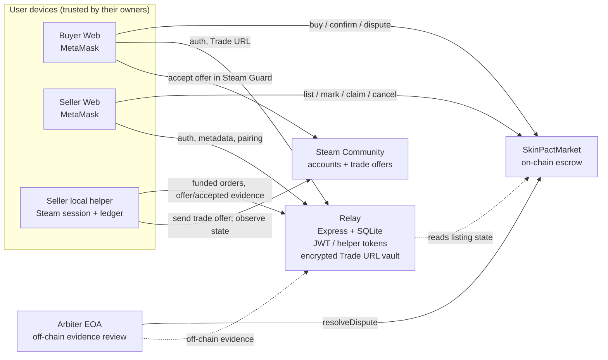

# E2 — Threat Model: SkinPact S2-mini

| Field | Value |
|---|---|
| Date | 2026-11-07 |
| Code under test | commit `6d8ffa0` (`feat(stage2)`) |
| Chain under test | Hardhat local 31337; Sepolia deployment is evidence-only for this experiment |
| Contract | `SkinPactMarket` (`contracts/contracts/SkinPactMarket.sol`) |
| Off-chain components | Relay (`relay/`), seller helper (`helper/`), React web (`web/`) |
| Steam | External; **not contacted** by automated tests. E2E labels Steam transport as MOCKED. |
| Tools | Hardhat 2.29.1, Node 22.23.2, Slither 0.11.6, solc 0.8.24+commit.e11b9ed9 |

This threat model is scoped to the course prototype. It does not claim production
security. The system is testnet-only: escrow is test ETH and the delivered asset is
an off-chain CS2 item.

---

## 1. System and trust boundaries

Trust boundaries:

1. **On-chain boundary.** The contract is the settlement authority. It has no
   owner, no emergency withdrawal, and no upgrade path. Code is immutable after
   deployment. The only privileged on-chain role is `arbiter`, fixed at
   construction (`SkinPactMarket.sol:46`, `:103-126`).
2. **Relay boundary.** The Relay sees wallet addresses, Steam IDs, item metadata,
   and buyer Trade URLs. It encrypts Trade URLs at rest with a key held by the
   Relay process. It cannot move escrow funds.
3. **Helper boundary.** The helper runs on the seller's machine. It holds the
   seller's Steam session and receives the buyer Trade URL for funded orders. It
   has no on-chain signing authority.
4. **Steam boundary.** Steam is the delivery system of record for the item. No
   part of the on-chain system can verify Steam state. The helper reports what it
   observes; the arbiter reviews evidence off-chain.
5. **Arbiter boundary.** The arbiter is trusted to interpret off-chain evidence
   and call `resolveDispute`. The contract enforces who may call and which
   outcomes are legal, but not whether the decision is fair.

---

## 2. Assets

| Asset | Where it lives | Impact if lost or leaked |
|---|---|---|
| Escrowed price (test ETH) | Contract balance | Buyer loses price; seller loses expected payment |
| Seller bond (test ETH) | Contract balance | Up to `price / 10` (min `minBond`) at risk |
| CS2 item | Steam inventory | Theft or non-delivery |
| Buyer Trade URL token | Relay SQLite (AES-256-GCM ciphertext) | Bearer secret: whoever has it can send a trade offer to the buyer |
| Seller Steam session / refresh token | Helper state directory (mode 0600) | Account access; offer manipulation |
| Steam offer evidence | Relay SQLite (encrypted) + hash on-chain | Wrong arbitration; privacy |
| Relay encryption key / JWT secret | Relay process environment | Decrypt Trade URLs; forge sessions |
| Arbiter key | Operator-controlled EOA | Wrongful settlement of any disputed order |
| Dispute evidence | Off-chain (helper/relay/manual) | Unfair or unverifiable arbitration |

---

## 3. Actors and capabilities

| Actor | Capabilities | Assumed honest? | Notes |
|---|---|---|---|
| Seller | Lists, marks offers, claims acceptance, cancels Active listings, disputes | No | Can also run a modified helper |
| Buyer | Buys, submits Trade URL, confirms receipt, disputes | No | Holds the Trade URL bearer secret |
| Outsider | Calls permissionless entry points (`expireOrder`, `finalizeClaim`, `openDispute` after delivery deadline) and public Relay reads | No | Cannot impersonate parties |
| Arbiter | Resolves Disputed listings | **Trusted** | Single immutable EOA in this prototype |
| Relay operator | Reads/decrypts stored Trade URLs, issues sessions, logs | **Semi-trusted** | Cannot move escrow; can leak privacy |
| Helper operator | Same as seller; observes Steam and uploads evidence | **Trusted to report truthfully** by the protocol | No on-chain role |
| Steam | Custody and transfer of the item | **Trusted for delivery, not for arbitration** | State is not verifiable on-chain |
| Local machine attacker | Can call helper loopback API, read process memory/files | Not assumed | Mitigated but not eliminated |
| Network attacker | Can replay, tamper, or drop HTTP traffic | Not assumed | TLS assumed for non-local Relay |

---

## 4. Threat scenarios

Status legend: **M** mitigated by code/tests; **P** partially mitigated / residual;
**A** accepted design limitation; **O** operational risk outside the code.

| ID | Threat | Adversary | Mitigation | Evidence | Status |
|---|---|---|---|---|---|
| T-01 | Call `markOfferSent`, `claimAccepted`, `cancelListing` as non-seller | Outsider | `NotSeller` checks | 36 contract tests; `markOfferSent` / `cancelListing` / `claimAccepted` suites | M |
| T-02 | Call `confirmReceipt` as non-buyer | Outsider | `NotBuyer` | `confirmReceipt` suite | M |
| T-03 | Call `resolveDispute` as non-arbiter | Outsider | `NotArbiter` | `resolveDispute` suite | M |
| T-04 | Double settlement after Completed/Refunded | Buyer / seller | Status guard before every settlement; terminal states reject repeat calls | double-settlement tests; E2E P1/P3 | M |
| T-05 | Reopen a settled claim or dispute | Either party | `ClaimPending`/`OfferSent`/`Disputed` guards; `NotDisputed` after resolution | `claimAccepted / finalizeClaim`, `openDispute`, `resolveDispute` suites | M |
| T-06 | Reuse an offer ID hash across listings | Seller | Global `usedOfferIdHash` mapping | `blocks reusing an offer hash across listings` | M |
| T-07 | Finalize a claim before the challenge window | Seller / outsider | `ChallengeNotExpired` check | `claimAccepted / finalizeClaim`; E2E P2 | M |
| T-08 | Mark an offer after the offer deadline | Seller | `OfferDeadlinePassed` check | `markOfferSent` suite | M |
| T-09 | Expire a Funded order before its deadline | Anyone | `OfferDeadlineNotReached` | `expireOrder` suite; E2E P3 | M |
| T-10 | Dispute after the challenge deadline | Buyer | `DisputeDeadlinePassed` | `openDispute` suite | M |
| T-11 | Fake `ClaimAccepted` without Steam delivery | Seller | Buyer can dispute before challenge ends; arbiter reviews off-chain evidence | E2E P7; findings F-01 | P/A |
| T-12 | Buyer disputes to freeze a valid claim (griefing) | Buyer | Arbiter must resolve; no buyer bond | E2E P7; findings F-04 | P/A |
| T-13 | Seller marks an offer but never sends it, locking buyer funds | Seller | Buyer can dispute from `OfferSent`; arbiter resolves | `openDispute` suite; findings F-05 | P/A |
| T-14 | Deadline liveness: nobody acts | All parties | `expireOrder`, permissionless `finalizeClaim`, post-delivery `openDispute` | contract tests; E2E P2/P3 | M |
| T-15 | Buyer accepts before the seller marks; chain cannot prove it | Buyer / seller | UI flow requires mark first; arbiter reviews evidence | findings F-06 | A |
| T-16 | Treat `InEscrow(11)` as final delivery | Seller | Helper maps state 11 to `held`, never `accepted`; no automatic claim | `helper/src/orders.ts:71-93`; helper test `maps Steam offer states...` | M |
| T-17 | Trade URL appears in API responses, DB plaintext, logs, or reports | Relay / observer | AES-256-GCM at rest; no-store; seller-only after funding; helper scope; terminal cleanup; log bodies/headers omitted | relay tests `trade-secrets`; E2E P4; findings F-03 | M/P |
| T-18 | Wrong wallet or outsider reads the buyer Trade URL | Buyer / outsider | On-chain seller/buyer checks; 403/409 responses | relay tests; E2E P4 | M |
| T-19 | Stolen Trade URL used to send a fraudulent offer | Anyone with the URL | Bearer-secret model; UI warns; delivery only to exact item; user must accept in Steam Guard | findings F-03 | A |
| T-20 | Replay a wallet login signature | Network attacker | One-time nonce, 5-minute TTL, deleted on use; chain ID and address in message | `auth.test.ts` (`rejects replay`) | M |
| T-21 | Forge or tamper with a Relay JWT | Outsider | HMAC-signed JWT, 1-hour TTL, signature and `sub` validation | `auth.test.ts` (`tampered JWTs`) | M |
| T-22 | Guess a helper pairing code | Outsider on the network | 6-digit code, hashed at rest, one-time use, 5-minute TTL, 10/min/IP rate limit | relay test `helper pairs with a one-time code`; findings F-12 | P |
| T-23 | Use a helper token on wallet-only routes or for another seller | Helper / outsider | `sp_helper_` prefix, SHA-256 token hash, seller-scoped queries | relay tests; E2E P4 | M |
| T-24 | Helper token theft | Local attacker | 0600 session file, 28,800 s TTL; no revocation endpoint | findings F-11 | P |
| T-25 | DNS rebinding against the helper loopback API | Web page | `Host` must be loopback; `Origin` must be allowlisted; server binds `127.0.0.1` | helper test `rejects DNS-rebinding hosts...` | M |
| T-26 | Malicious web origin triggers helper login/QR actions | Web page | Origin allowlist; QR data URL is not exposed by status endpoints | helper test `pairing and login start accept JSON only from the local Web origin`; `unknown routes...QR payload` | P |
| T-27 | Trade URL or token leaks through error messages | Third-party error | `safeErrorMessage` redacts URLs and `token=/partner=` values | helper test `redacts accidental URL/token material...` | M |
| T-28 | Malicious local ledger causes duplicate offers | Local corruption / attacker | Ledger schema validation; refuses to start on malformed state; exact-offer adoption instead of blind retry | helper tests `malformed local ledger...`, `matches only one exact active sent offer` | M |
| T-29 | Reentrancy during `withdraw` | Credited account | OpenZeppelin `ReentrancyGuard`; credit zeroed before the call; pull-payment pattern | `withdraw` suite; Slither low-level-call result | M |
| T-30 | Withdraw failure traps funds | Recipient contract | Call failure reverts; balance remains credited; retry possible | `withdraw` suite | M |
| T-31 | Price/bond bound bypass | Seller | `maxPrice`, exact bond, `minBond` | `createListing` suite | M |
| T-32 | Duplicate active listing for the same item | Seller | `activeItemHash` one-listing guard; cleared on terminal states | contract tests; E2E P5 | M |
| T-33 | Self-buy / wash trade | Seller | `SelfBuy` check | `buy` suite | M |
| T-34 | Reviewer/validator shifts a deadline boundary by seconds | Block producer | Timestamps are used only for coarse windows (300–3,600 s); no per-second value | Slither timestamp findings; findings F-14 | A |
| T-35 | Relay compromise (host + key) decrypts all Trade URLs | Host attacker / insider | AES-256-GCM; key separate from DB in env; least data retention; deletion on terminal | findings F-03 | A/P |
| T-36 | Arbiter key loss or abuse | Arbiter / thief | Immutable address; off-chain policy; dedicated EOA for demo | findings F-02 | A |
| T-37 | Relay rate limits bypassed by restart or distributed IPs | Outsider | In-memory per-IP limits only | findings F-16 | P |
| T-38 | Metadata privacy leak (wallet, SteamID, asset IDs public) | Observer | Public by design for the marketplace demo | findings F-17 | A |
| T-39 | Challenge notification missed by buyer | Buyer | UI countdown/polling only; no push/email | findings F-07 | P |
| T-40 | Arbiter cannot read evidence through the Relay | Arbiter | No evidence-read endpoint; off-chain manual records | findings F-09 | A |
| T-41 | Seller cannot abort a Funded order | Seller | Only `expireOrder` after offer deadline; no `abortBySeller` | findings F-08 | A |
| T-42 | Item is not actually transferable (Steam hold/trade ban) | Seller | UI/helper validation of item and account; Steam rejects offer; buyer disputes | findings F-01; MVP limitations | P/A |

---

## 5. Explicitly out of scope

- Mainnet or real-money use. Both the README and all deliverables must state
  testnet-only.
- Steam account takeover, phishing, malware on user devices, and Steam's own
  security model.
- Smart-contract language/compiler bugs, OpenZeppelin library bugs, and EVM-level
  attacks.
- Denial of service against Sepolia RPC or Steam Community.
- Privacy regulation and data-retention compliance.
- Social engineering of the arbiter.
- Any claim that the on-chain hash proves delivery.

---

## 6. Methodology and evidence base

| Layer | Method | Result |
|---|---|---|
| Contract | 36 Hardhat tests including unauthorized callers, state bypasses, double settlement, challenge windows, accounting invariants | 36 passing |
| Contract + Relay | `npm run e2e:local`, P1–P8, real in-process Relay + SQLite, mocked Steam transport | 99 checks passing |
| Relay | 18 `node:test` tests: nonce/JWT, URL encryption and access, helper pairing, evidence idempotency, cleanup | 18 passing |
| Helper | 12 tests: state mapping, redaction, loopback/origin/DNS-rebinding, ledger recovery | 12 passing |
| Static analysis | Slither 0.11.6 on `SkinPactMarket.sol`, OpenZeppelin filtered | 5 informational results, 0 High/Medium |
| Coverage | `npx hardhat coverage` | 100% statements/functions/lines, 87.5% branches |

Raw outputs: [`slither.txt`](./slither.txt), [`coverage.txt`](./coverage.txt),
[`findings.md`](./findings.md), [`trust-table.md`](./trust-table.md).

---

## 7. Assumptions that, if broken, invalidate the analysis

1. The Relay host is not malicious and its environment variables are not read by
   an attacker.
2. The arbiter acts in good faith or under an accountable policy.
3. The seller's machine is not compromised while the helper session is valid.
4. The buyer keeps the Trade URL secret and confirms only after checking the
   received item.
5. Steam trade offers are the delivery mechanism; the CS2 item is outside the
   escrow contract.
6. Test ETH has no monetary value.
