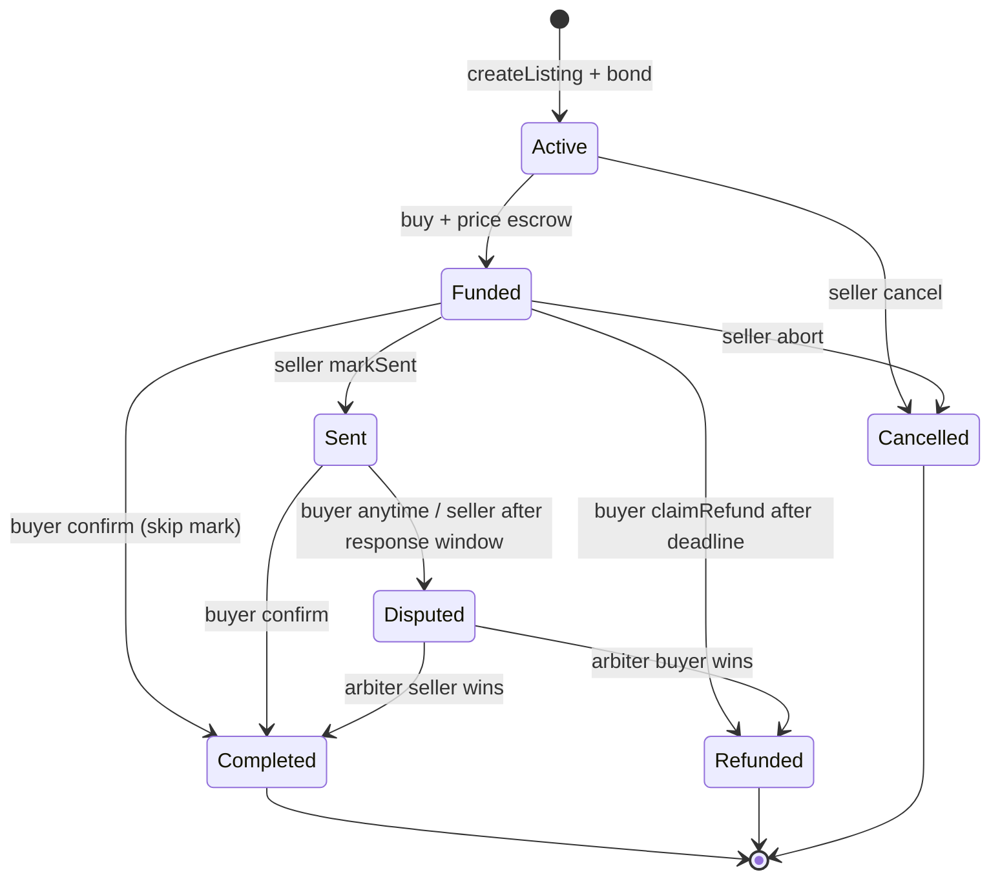
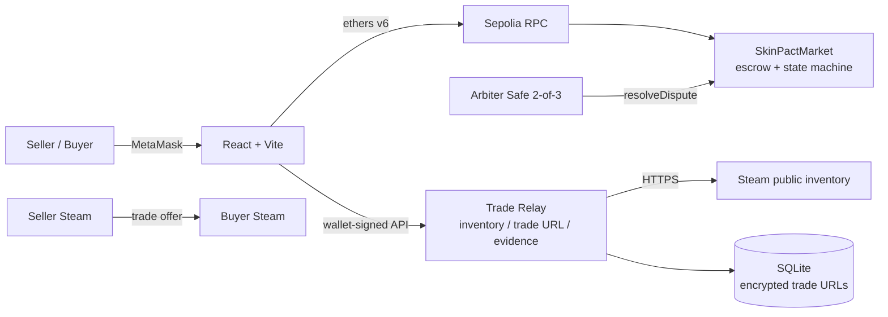

# DApp 期末项目 MVP Spec（SkinPact）

**状态**：待 review · **版本**：v2.1（review 精简版） · **团队人数**：`{N}`（4–5） · **截止**：2026-11-08 23:59

> CS2 饰品的 P2P 链上托管结算协议：**钱在合约里，货走 Steam，平台不碰库存、不收交易费。**
>
> 本文只冻结方向、范围、关键规则、时间与评审点；合约/前端/中继/实验等实施细节放 SPEC-1~6。

---

## 1. 项目是什么 & 为什么成立

### 1.1 问题

- BUFF/UU 类平台收取约 2%–3% 的交易服务费（以各平台公示为准），叠加提现/时间成本。
- 为自动收发货，平台通常先托管饰品；平台 bot/库存成为中心化对手方（被盗、封号、冻结、跑路）。
- 直接 P2P 有 Steam trade offer，但没有「一手交钱、一手交货」的支付托管：买家怕不发货，卖家怕不付款。

### 1.2 方案

- 卖家链上挂牌（价格、保证金、交付窗口、物品元数据 hash）。
- 买家把 **testnet ETH** 存入合约托管。
- 卖家在 Steam **直接**向买家发 trade offer，饰品不进平台。
- 买家在 Steam 验货后链上确认 → 合约结算；超时退款；争议仲裁。
- **0 平台交易费**（只有 gas），非托管，保证金 + 买家确认 + 仲裁覆盖链下交付风险。
- 定位是 **P2P 固定价托管市场**，不是 AMM/订单簿 DEX；不发 token/NFT；只做 testnet。

### 1.3 评审必须先接受的关键约束

- Steam **没有官方 API 允许第三方代用户创建 trade offer**。全自动只能靠持有饰品的 bot（BUFF/UU 模式）或用户登录态，这与「平台不碰库存」冲突。
- 因此 P0 选择 **非托管 + 卖家在 Steam 客户端手动发 offer + DApp 引导/记录**。这是本项目的核心 trade-off，不是待修 bug。
- 链上能保证资金、规则与审计；**不能保证物品一定送达**。交付验证 = 买家确认 + 保证金 + 仲裁；仲裁员和中继是残余信任点。
- 如果评审更想要「全自动」而不是「非托管」，那是另一个 custodial bot 架构，需要改项目定位（P2），不在本文范围。

### 1.4 为什么值得上链

- escrow、保证金、0 费率、结算记录公开可验证；平台无法卷走资金或临时改规则。
- 饰品始终在用户自己的 Steam 库存里，平台没有「先收走饰品」的机会。
- 诚实边界：仅做数据库也能实现流程；链上的价值在可信托管与审计。报告会用实验量化成本与信任，而不是只说口号。

---

## 2. 课程要求与交付（Review 依据）

- 硬性：Sepolia、Solidity、ethers.js、MetaMask、至少一次有意义的链上操作；4–5 人；**2026-11-08 23:59**；英文视频/报告/slides；public repo + README。
- 评分：Codebase **35%** / Experiment **35%** / Demo **15%** / Coherence **15%**；迟交 10/20/50/100%。
- 课程最低线已由链上托管闭环覆盖；Steam 是特色与最大风险。真实链路受阻时按附录 A 使用**明确标注**的 mock，不伪造，也不牺牲链上闭环/报告/视频。
- 交付命名：`{N}-SkinPact.pdf`、`{N}-SkinPact.pptx`、`{N}-SkinPact-video.txt`；Sepolia verified 地址；贡献表。
- 声明：testnet-only、无真实货币/贵重饰品、与 Valve/Steam/BUFF/UU 无关联、仅课程作业。

---

## 3. 范围

### 3.1 角色

| 角色 | 职责 |
|---|---|
| Seller | 导入 Steam 库存、挂牌、锁保证金；在 Steam 客户端发 offer；markSent；提现 |
| Buyer | 提交自己的 trade URL、支付托管、在 Steam 接受并验货、链上确认、退款/争议 |
| Arbiter | 仅对 `Disputed` 做链上裁决；P0 建议团队 2-of-3 Safe |
| Relay（链下） | 拉 Steam 公开库存、生成元数据/hash、加密保管 trade URL、存证；**不碰资金/凭证/饰品** |
| Observer | 无钱包只读浏览、审计链上状态 |
| Steam | 物品真实归属与转移；trade offer；本项目「货」的腿 |

### 3.2 主流程（P0）

1. Seller 输入 SteamID64 → Relay 拉公开库存 → 选物品 → 链上 `createListing`（锁 bond）。
2. Buyer 提交自己的 trade URL（Relay 加密）→ 支付 `price` → `Funded`。
3. Seller 在 Steam 客户端发 offer → 回 DApp `markSent`（记录 offer hash）。
4. Buyer 在 Steam 接受并核验 → 链上 `confirmReceipt` → `Completed`；双方 `withdraw`。
5. 卖家超时未发 → Buyer `claimRefund`；卖家未发前可 `abortBySeller`；`Sent` 后可争议 → Arbiter 裁决。
6. 全流程 0 平台费；trade URL 不上链、不公开、只给成交卖家。

### 3.3 状态机

- `Active`/`Funded`/`Sent`/`Disputed` 持有资金；终态把金额记入 `withdrawable`。
- 超时退款：price 退买家、bond 退卖家（**不自动没收 bond**，防止买家「不提供 URL → 薅保证金」）。
- 卖家中止：price + 10% bond 退买家；争议买家胜：price + 50% bond 退买家。其余 bond 退卖家。
- 细节（边界、事件、错误码、不变量）在 SPEC-1。

### 3.4 关键规则（冻结点）

| 项 | P0 |
|---|---|
| 平台费 | **0**；合约无费率/treasury/owner 提款函数 |
| 保证金 | `max(minBond, price × 10%)`；从创建锁到终态 |
| 购买 | 精确 `price`；禁止自买；资金进入合约托管 |
| 卖家发送 | 只能在 deadline 前 `markSent`；`Sent` 不等于合约验证已发货 |
| 买家确认 | `Funded` 或 `Sent` 可确认；终局不可撤销；UI 强制核验清单 |
| 超时 | 卖家未发送 → 买家取回本金；bond 退回卖家 |
| 中止 | 卖家在 `Funded` 可中止，补偿 10% bond 给买家 |
| 争议 | 买家 `Sent` 可发起；卖家等待期后可发起；仅 Arbiter 裁决 |
| 提现 | pull payment；CEI + `nonReentrant` |
| Trade URL | 仅链下、加密、成交卖家可见；不上链/不写日志；终态清除 |
| 风险上限 | `maxPrice` 默认 0.1 test ETH；testnet only |
| NFT | P0 不发；P1 可加「成交收据」但只作记录，不声称拥有 Steam 物品 |

**关键验收（详细用例在 SPEC-1/2）**：错金额/自买/已成交取消必须 revert；确认后卖家可提取 price+bond；超时买家可取回 price；非 Arbiter 不能裁决；合约余额不变量始终成立；未授权拿不到 trade URL。

### 3.5 优先级 / cut line

- **P0**：合约全域状态机 + bond + pull payment + 测试/invariant + Sepolia verify；Relay（钱包登录、库存、加密 trade URL、证据、mock）；前端市场/详情/卖品/Dashboard/Trade Room/Arbiter/FAQ；真实库存 + 半自动 Steam（真实 offer 或明确标注的 mock）；E1–E3；报告/视频/slides/README/CI。
- **P1**：Steam OpenID、链上库存 attestation、成交流水 NFT、float/pattern、USDC 测试币、L2 部署、议价/批量、信誉、通知。
- **P2**：bot 托管/自动收发、真实货币/主网、AMM/订单簿、平台 token/ICO、保险、DAO 仲裁、法币出入金、移动 App、赌博/开箱。
- **11-04 23:59 功能冻结**；此后只修 bug、做实验与文档。时间不够按附录 A。

### 3.6 Demo 数据与降级

- 使用团队**自己的两个 Steam 账户**（Seller A / Buyer B）和团队拥有的低价值、已过冷却、可交易物品；不用贵重饰品；准备 2 件以上以便重拍。
- 优先真实公开库存 + 真实 Steam offer；不行则「真实库存 + 明确标注 mock trade」；最后才是全 mock 本地，视频必须标注。
- Demo 参数：price 0.01 test ETH、bond 0.001、deliveryWindow 1–10 分钟（仅 demo 部署，视频明示）；正常建议 24h。
- 视频遮挡 Steam 账号名、好友、头像、trade URL token、邮箱等个人信息。

---

## 4. 架构与信任边界

- **链** = 资金与状态的事实来源；前端关键操作前从链上重读。
- **Steam** = 物品事实；链上无法验证；买家必须自己核验。
- **Relay** = 库存/元数据/trade URL/证据；隐私信任点，不碰资金、凭证、饰品；可被攻击或宕机，但动不了合约资金。
- **Arbiter** = 争议裁决；中心化信任点，P0 用 2-of-3 Safe，报告中明确承认。

### 4.1 关键设计决策

| ID | 决策 | 原因 / 代价 |
|---|---|---|
| D1 | 链上托管资金，**不托管饰品** | 避开平台 bot 风险；代价是最后一步卖家手动 |
| D2 | Steam offer 由卖家发起，DApp 引导/记录 | 无官方代发 API；全自动 = bot 托管；核心 trade-off |
| D3 | pull payment（`withdrawable` + `withdraw`） | 防收款方阻塞；代价是多一笔提现 gas |
| D4 | 买家确认 + 保证金 + 仲裁验证交付 | Steam 不可直接上链；买家误确认/仲裁信任是残余风险 |
| D5 | 保证金 + 有限自动罚则；超时不自动没收 bond | 防买家薅 bond；假单卖家只损失时间/gas |
| D6 | P0 不发 NFT/token | Steam asset_id 会变，NFT 不赋予物品所有权；P1 收据仅作记录 |
| D7 | 元数据链下 + 链上 hash/URI | 降 gas；代价是可用性依赖 Relay；P1 IPFS/签名 |
| D8 | 核心参数不可变；owner 只能换 arbiter；无费率/暂停/升级 | 让「0 费/规则不变」可信；bug 需迁移；仲裁仍中心化 |
| D9 | Relay 钱包签名 + 加密 trade URL + 最小保留 | 隐私/限流需要链下代理；Relay 是隐私信任点 |
| D10 | Testnet ETH + `maxPrice` + 不碰真实价值 | 课程合规/安全阀；真实产品需稳定币/L2 |

### 4.2 Steam 现实（评审重点）

- 公开库存端点可只读拉取物品；trade URL 是接收 offer 的 secret；物品交易后 `asset_id` 会变。
- 没有官方「代用户创建/接受 offer」API；未官方库/bot 需要账号会话或持有饰品，等于是托管。
- Trade hold（可能最多 15 天）与 7 天交易冷却会卡 demo；Stage 0 必须先用两个自有账号验证。
- 因此本项目的 Steam 集成 = 库存校验 + trade URL 中转 + 手动 offer 引导 + 买家确认 + 证据/仲裁；详见 Stage 0 与 SPEC-2。

### 4.3 安全底线

- 合约：OZ 实现、CEI、`nonReentrant`、精确金额、角色校验、custom errors/events、invariant 测试、Slither。
- Relay：TLS、CORS、限流、wallet-signed JWT、加密、无 trade URL 日志、无 Steam 凭证；链上资金不受 Relay 攻破影响。
- 合规：testnet、低价值/自有物品、遮挡个人信息、不碰赌博/真实货币、非官方关联声明。

---

## 5. 实验（Review 级别）

| ID | RQ | 方法 | 产出 |
|---|---|---|---|
| **E1** | 各操作的 gas 成本多少？在哪些饰品价位比 2%–3% 平台费更便宜/更贵？L1 vs L2 如何？ | 测 create/buy/markSent/confirm/refund/abort/dispute/withdraw；本地 + Sepolia；主网 gas/ETH 敏感性；平台费率 1%/2.5%/5% 情景 | CSV + 盈亏平衡图 + 费用对比表 |
| **E2** | 合约能否抵抗越权/重入/状态绕过？残余信任点？保证金是否有激励漏洞？ | 威胁模型 + 对抗测试 + invariant + Slither + coverage；「买家不提供 URL 薅 bond / 卖家假单」的期望收益分析 | 测试报告 + findings + 信任表 |
| **E3** | 新用户能否理解「链上托管 + Steam 手动交付」并完成购买/确认/退款？ | 5–8 名同学/玩家，mock Steam + 预充值钱包；任务、用时、错误、SEQ/SUS、访谈；匿名同意 | 漏斗图 + 表格 + 改进项 |
| E4（可选） | Sepolia 确认延迟/失败率是否可接受？ | 10–20 笔交易；不同 RPC | p50/p95 + 失败率 |

- E1 必须诚实：**低单价饰品在 L1 上可能比平台费更贵**；结论应指向 L2/稳定币，而不是硬说更便宜。竞品费率需附来源/日期。
- 实验协议、数据字段、复现命令在 SPEC-3；报告围绕 E1–E3 组织（约 40–50% 篇幅）。

---

## 6. 阶段计划

**角色**：R1 PM/报告；R2 合约/安全；R3 前端/Relay/Steam；R4 数据/实验；R5 视频/slides。4 人时合并 R4 到 R2 或 R5。

| Stage | 日期 | 主线 | 退出标准 |
|---|---|---|---|
| **S0 可行性确认（Stage 0）** | 11-02 | 用团队自己的两个 Steam 账户做 go/no-go（见下） | API/链接可行性结论 + 两个自有账号的链接/offer 证据 |
| **S1 垂直切片** | 11-03 | 合约 create/buy/markSent/confirm + 测试；Relay 库存/登录/URL vault；前端钱包 + 市场 + 卖品；本地 E2E | 本地链 happy path 全通；前端能拉库存并看到状态 |
| **S2 闭环 + 部署** | 11-04 | refund/abort/dispute/resolve + Slither；Trade Room/Dashboard/Arbiter；Sepolia 部署 + verify + E2E；**23:59 功能冻结** | Sepolia 上 UI 完成 create→buy→markSent→confirm→withdraw；退款/中止有证据 |
| **S3 实验 + 彩排** | 11-05 | E1/E2/E3 数据；图表；两次 demo 彩排；视频脚本；slides 草稿 | 数据/图表入库；彩排通过；脚本 ≤14 min |
| **S4 报告 + 录制** | 11-06 | 报告全文；内部 rubric 自评；录制/上传视频；slides | 报告 review 通过；视频/ slides 可提交 |
| **S5 QA + 提交** | 11-07 | clean clone、README、贡献表、命名、无 secret；**目标 21:00 前提交** | 全部交付物可访问；凭证保存 |
| 11-08 | 缓冲 | 只处理提交平台故障 | 截止前可提交 |

### Stage 0 出口（冻结）

> 用团队**自己的两个 Steam 账户**（A=卖方，B=买方）：给定 **A 的 SteamID64 + 饰品信息**（asset_id / classid / inspect link），调用 Steam API **能拿到一个可打开的链接**；**A 能收到/打开该链接**，B 能看到对应 offer；明确记录链接类型（inspect link / trade URL / trade offer link / DApp listing link），留存 API 响应、截图、offer ID。
>
> 若官方 API 不能代 A 发起 trade offer，**当天记录具体阻塞**，并把 P0 固定为「卖家手动发 offer + DApp 记录」或明确标注的 mock；不因此拖到后续阶段才发现。

- Stage 0 不需要合约/前端完成；它是 API/账号/链接的技术 spike。
- 若你们已选定某个第三方交易 API，把它写进 Stage 0 的测试记录，替换「当前可用的 Steam API」这一模糊表述。

---

## 7. 需要评审拍板的事

| ID | 决策 | 默认建议 | 需要谁 |
|---|---|---|---|
| R-1 | 接受「非托管 + 卖家手动 offer」还是改做 bot 托管全自动？ | 非托管半自动（与项目定位一致） | 全队 |
| R-2 | 0 平台费 / 未来治理费？ | P0 0 费；治理费只写 future work | 全队 |
| R-3 | P0 是否保留争议仲裁？ | 保留最小版；时间不够按附录 A 降级 | 全队 |
| R-4 | P0 是否完全不发 NFT？ | 是；P1 收据 NFT 仅作记录 | 全队 |
| R-5 | Arbiter 用单 EOA 还是 2-of-3 Safe？ | Safe；demo 可单 EOA 但报告说明 | R2/R1 |
| R-6 | 视频用真实 Steam 交易还是真实库存 + 标注 mock？ | 先冲真实；不行则明确标注 mock | R3/R5 |
| R-7 | `{N}` 团队人数与角色？ | 5 人，按 §6 | 全队 |
| R-8 | Stage 0 若失败，接受 P0 固定为手动 + mock？ | 是，保证课程交付 | 全队 |

### 7.1 主要风险

| 风险 | 缓解 |
|---|---|
| 6 天 scope 失控 | 11-04 23:59 冻结；P0/P1/P2 硬切；附录 A |
| Steam 不可交易 / trade hold / 冷却 | Stage 0 用两个自有账号验证；准备备用物品；mock 明确标注 |
| 误以为能全自动发 offer | 本文 §1.3/§4.2 先对齐；Stage 0 实证；报告写清 |
| trade URL 泄露 | 加密、最小权限、无日志、终态清除、视频遮挡 |
| 合约 bug / 资金风险 | testnet + `maxPrice` + CEI/pull/nonReentrant + invariant + Slither |
| 买家误确认 / 卖家发错物品 | 强制核验清单 + 二次确认；证据/仲裁；P1 float |
| 仲裁中心化 / Relay 隐私 | 2-of-3 Safe、透明记录、加密、短保留；报告 limitation |
| 0 费率被 L1 gas 打脸 | E1 做盈亏平衡；结论指向 L2/稳定币，不夸大 |
| 现场 demo 失败 | 预充值账户、两次彩排、预录 backup、明确 mock 兜底 |

### 7.2 待确认问题

- Steam 两个账号是否已启用 Mobile Authenticator > 7 天，且有可交易、非冷却的低价值物品？
- 是否接受 Stage 0 可能得出「无法自动创建 offer」的结论并按手动 + mock 落地？
- BUFF/UU 费率来源/日期？是否接受 1%/2.5%/5% 敏感性情景？
- 视频是否允许出现「真实库存 + 标注 mock」？还是必须全程真实？
- 是否额外部署 L2 做 E1 对比？P0 默认不做。
- 是否使用 Steam OpenID？P0 默认不做（钱包签名 + trade URL 足够）。
- 是否保留 `{N}` 4–5 人？如果少于 4 人，按 SPEC-6/附录 A 减角色。

---

## 8. 交付清单（Review 用）

- [ ] 报告 PDF `{N}-SkinPact.pdf`：problem → design → implementation → E1–E3 → limitations → contribution。
- [ ] Slides `{N}-SkinPact.pptx`；视频 `{N}-SkinPact-video.txt`（unlisted + 备份）。
- [ ] 视频 ≤15 min、1080p、英文；Steam 个人信息遮挡；真实/模拟标注一致。
- [ ] Public repo + README + CI + tests；Sepolia 合约 verified 地址；`deployments/sepolia.json`。
- [ ] 实验 CSV/脚本/复现命令；竞品费率来源与日期。
- [ ] 无 `.env`、私钥、trade URL、Steam 凭证、真实个人信息；非官方关联声明。

---

## 9. 细节去向（后续 SPEC）

| Spec | 内容 | Owner | Due |
|---|---|---|---|
| SPEC-1 | 合约接口、状态机边界、保证金/仲裁参数、事件/错误、invariant/测试矩阵 | R2 | 11-02 |
| SPEC-2 | 前端页面、Trade Room、钱包错误处理、Relay API/权限/trade URL 生命周期 | R3 | 11-02 |
| SPEC-3 | E1–E3 实验协议、字段、样本、费用来源、复现方式 | R4 | 11-03 |
| SPEC-4 | 报告大纲、评分映射、图表清单、引用规范 | R1 | 11-04 |
| SPEC-5 | 视频分镜、英文旁白、真实/模拟标注、fallback | R5 | 11-05 |
| SPEC-6 | 提交检查表、命名、clean-clone、凭证 | R1 | 11-07 |

> 本文不再展开合约结构体、完整函数表、Relay 端点、元数据 JSON、长风险矩阵等；这些都属于上述实施 spec。这里只保留评审需要的方向、边界、时间与风险。

---

## 附录 A：最低可交付 / 降级

- **Steam 真实交易做不了**：保留真实公开库存 + **明确标注**的 mock trade（UI banner / 视频口播 / README 三处一致）；不伪造。
- **时间不够**：合约保留 create/buy/markSent/confirm/claimRefund/abort/withdraw；争议可降为单 arbiter；E1+E2 必做，E3 可改 heuristic evaluation；E4 砍掉。
- **不砍**：合约测试/invariant、README、真实/模拟标注、报告、视频、贡献表、无 secrets。
- 任何降级由 R-1/R-8 确认，并写进报告 limitations。

## 附录 B：Stage 0 记录模板

| 字段 | 记录 |
|---|---|
| 卖方账户 | SteamID64（不公开） |
| 饰品 | asset_id / classid / market name / inspect link |
| 调用端点 | 具体 URL、是否需要 API key/登录态 |
| 返回链接类型 | inspect link / trade URL / trade offer link / DApp link |
| 卖方能否收到/打开 | 是/否 + 证据截图 |
| 买方能否看到 offer | 是/否 + offer ID |
| 结论 | go / no-go；若 no-go，阻塞点与 P0 备选方案 |
