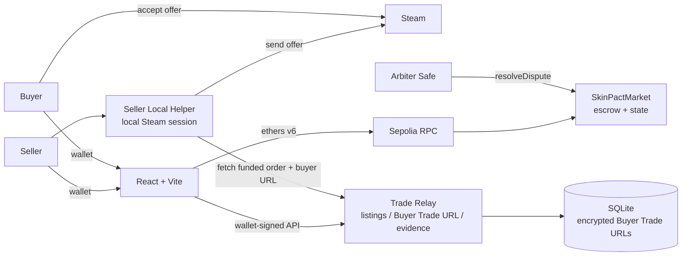

# DApp 期末项目 MVP Spec（SkinPact）

**状态**：待 review · **版本**：v2.6（Plan A Stage 0 已验证 + 结算兜底，review 精简版） · **团队人数**：`{N}`（4–5） · **截止**：2026-11-08 23:59

> CS2 饰品的 P2P 链上托管结算协议：**钱在合约里，货走 Steam，平台不碰库存、不收交易费。**

> 本文只冻结方向、范围、关键规则、时间与评审点；实施细节放 SPEC-1~6。
>
> v2.3 变更：采用 **Plan A** —— 卖家本地 helper 用自己的 Steam 登录态直接向买家 Trade URL 发 offer；平台不保存 Steam 会话、不托管饰品；买家在 Steam 手机接受后在 DApp 确认。
>
> v2.4（2026-11-03）：**Stage 0 Steam 链路已验证** —— offer `#9464202838` 由本地 helper 从卖家账号发出，初始 `pending`，卖家 Steam 手机确认后买家接受，物品到账、**无 hold**；平台未参与/未保存 seller session。Relay reveal、链上 `markOfferSent`、DApp `confirmReceipt` 仍待 S1/S2。
>
> v2.5（2026-11-03）：明确**买家不确认的结算兜底** —— helper 观察 Steam `Accepted(3)` 后，Seller 可 `claimAccepted(evidenceHash)` 进入 `ClaimPending`；买家在挑战窗口内可 `confirmReceipt` 快速结算或 `dispute`，否则任何人可 `finalizeClaim` 自动放款。合约不读 Steam；**没有二次扣款**，只有 escrow 放款。
>
> v2.6（2026-11-03）：明确 **`markOfferSent` 不是放款条件**，卖家不能仅凭“已发 offer”拿走 escrow；必须 Buyer 确认或 Accepted claim finalize。`Funded` 超时仍无 `OfferSent` → 任何人可 `expireOrder` 触发退款（合约不会自己定时执行）。补充 §3.7：test ETH 计价/escrow/提现与 gas 分工。

**相关 Spec**

| Spec | 文件 | 关系 |
|---|---|---|
| Stage 0 | [2026-11-02-stage-0-steam-tradeoffer-spec.md](./2026-11-02-stage-0-steam-tradeoffer-spec.md) | 卖家本地 helper/登录态发 offer 的可行性；§3/§6/§9 以其结论为准 |

> 本表只列当前 `specs/` 中已存在的 Spec。

---

## 1. 项目是什么 & 为什么成立

### 1.1 问题

- BUFF/UU 类平台收取约 2%–3% 的交易服务费（以各平台公示为准），叠加提现/时间成本。
- 为自动收发货，平台通常托管饰品或持有用户 Steam 会话；平台成为中心化对手方。
- 直接 P2P 有 Steam trade offer，但没有「一手交钱、一手交货」的支付托管：买家怕不发货，卖家怕不付款。

### 1.2 方案（Plan A）

- 卖家链上挂牌（价格、保证金、物品元数据 hash）；饰品**始终留在卖家库存**。
- 卖家在本地运行 **helper**，用自己的 Steam 登录态登录 Steam（session 仅在本机）；helper 可在成交后直接发 offer。
- 买家选择商品，提交**自己的 Trade URL**（私密），把 **testnet ETH** 存入合约托管。
- 付款后，Relay 只向该卖家/helper reveal 买家 Trade URL；helper 从卖家账号向买家发 offer，选中正确物品。
- 卖家在链上 `markOfferSent(offerIdHash)`（用户钱包签名）；买家在 Steam 手机接受，再在 DApp 确认；合约结算。买家接受后离开 DApp 也不影响资金安全：helper 观察到 `Accepted(3)` 后，卖家可 `claimAccepted(evidenceHash)`，挑战窗口结束且无人争议后，任何人可 `finalizeClaim` 放款给卖家。
- **0 平台交易费**（只有 gas）；平台不保存卖家 Steam 会话、不托管饰品；买家必须在 Steam Accept，无法由平台替代。

### 1.3 评审必须先接受的关键约束

- Steam 没有官方 API 代创建/接受 trade offer；OpenID/API key 不够。Plan A 的登录态在**卖家本地 helper**，使用未官方 session 接口；平台本身不持有会话。
- 买家**必须**在 Steam 接受 offer（手机令牌）；平台不能替 Buyer Accept。卖家 helper 发 offer 也可能需要 Steam Guard 手机确认。
- 平台不托管饰品；卖家从自己的库存发；如果 seller helper 离线/登录失效，降级为卖家手动发送或明确标注的 mock。
- 如果要求“平台后端保存用户 Steam 会话”或“平台 Bot 先收饰品”，那是账号托管/饰品托管，属于 P2，不是 Plan A。
- 链上能保证资金、规则与审计；**不能验证 Steam 交付**。结算有两条路径：Buyer `confirmReceipt`（快速）或 Seller `claimAccepted` + 买家挑战窗口后 `finalizeClaim`（买家不确认的兜底）；两者都依赖链下证据/仲裁，Arbiter 与 Relay 是残余信任点。
- **不存在“交易成功后自动从买家钱包扣钱”**：买家在 `buy` 时已把 `price` 存入 escrow；MetaMask 不能无签名扣款。这里说的“自动”只是挑战窗口后**自动放款给卖家**。
- **不能以 Seller `markOfferSent` 作为放款条件**：那只是“已发 offer”的声明，买家还没接受、物品还在卖家库存；此时打钱会变成“卖家收钱后可以不交付”。放款必须等 Buyer 确认，或 Accepted claim 的挑战窗口结束。

### 1.4 为什么值得上链

- escrow、保证金、0 费率、结算记录公开可验证；平台无法卷走资金或临时改规则。
- 饰品始终在卖家 Steam 库存，平台没有「先收走饰品」的机会。
- 诚实边界：仅做数据库也能实现流程；链上的价值在可信托管与审计。报告会用实验量化成本与信任。

---

## 2. 课程要求与交付（Review 依据）

- 硬性：Sepolia、Solidity、ethers.js、MetaMask、至少一次有意义的链上操作；4–5 人；**2026-11-08 23:59**；英文视频/报告/slides；public repo + README。
- 评分：Codebase **35%** / Experiment **35%** / Demo **15%** / Coherence **15%**；迟交 10/20/50/100%。
- 课程最低线已由链上托管闭环覆盖；Steam/helper 是特色与最大风险。真实链路受阻时按附录 A 使用**明确标注**的 mock，不伪造。
- 交付命名：`{N}-SkinPact.pdf`、`{N}-SkinPact.pptx`、`{N}-SkinPact-video.txt`；Sepolia verified 地址；贡献表。
- 声明：testnet-only、无真实货币/贵重饰品、与 Valve/Steam/BUFF/UU 无关联、仅课程作业。

---

## 3. 范围

### 3.1 角色

| 角色 | 职责 |
|---|---|
| Seller | 导入 Steam 库存、挂牌、锁保证金；运行本地 helper（自己的 Steam 登录态）；确认 offer 发送并在链上 `markOfferSent`；提现 |
| Seller Local Helper | 卖家本机进程；用 seller 的 Steam session 向买家 Trade URL 发 offer；上报 offer ID；**不把 session 交给平台** |
| Buyer | 选择商品、提交自己的 Trade URL、支付托管；在 Steam 手机接受 offer；链上确认收货；退款/争议 |
| Relay（链下） | 拉 Steam 公开库存、生成元数据/hash；加密保管买家 Trade URL，仅 Funded 后向该 seller/helper reveal；存 offer 证据；**不碰资金/凭证/饰品** |
| Arbiter | 仅对 `Disputed` 做链上裁决；P0 建议团队 2-of-3 Safe |
| Observer | 无钱包只读浏览、审计链上状态 |
| Steam | 物品真实归属与转移；买家必须亲自 Accept |

### 3.2 主流程（P0）

1. Seller 输入 SteamID64 → Relay 拉公开库存 → 选物品 → 链上 `createListing`（锁 bond；饰品留在卖家库存）。
2. Seller 本地启动 helper，登录自己的 Steam（session 只在本地）；平台不保存。
3. Buyer 选择商品、提交**自己的 Trade URL**（Relay 加密）→ 支付 `price` → `Funded`。
4. Relay 仅向该 seller/helper reveal Buyer Trade URL；helper 从 seller 账号发 offer（选中目标物品）→ 拿 `tradeofferid`。
5. Seller 在链上 `markOfferSent(orderId, offerIdHash)`（钱包签名）；helper 轮询该 sent offer；Buyer 在 Steam 手机 Accept。
6. **快速路径**：Buyer 在 DApp `confirmReceipt` → `Completed`。**兜底路径**：helper 观察到 `Accepted(3)` 后，Seller 用钱包 `claimAccepted(orderId, evidenceHash)` → `ClaimPending`；挑战窗口内 Buyer 可 `confirmReceipt` 或 `dispute`；无争议则任何人可 `finalizeClaim` → `Completed`，Seller 的 `price + bond` 进入 `withdrawable`。
7. **无 offer 退款**：`Funded` 超时仍无 `OfferSent` → 任何人可 `expireOrder` → `Refunded`（本金退 Buyer、bond 退 Seller）。helper 离线/失败 → 卖家手动发送；其余超时/争议按 SPEC-1。
8. 双方 `withdraw`。0 平台费；平台不保存 seller session/不托管饰品；Buyer Trade URL 不上链、不公开。

### 3.3 状态机

```mermaid
stateDiagram-v2
  [*] --> Active: createListing + bond
  Active --> Funded: buy + price escrow
  Active --> Cancelled: seller cancel
  Funded --> OfferSent: seller helper sends + seller markOfferSent
  Funded --> Completed: buyer confirm (seller forgot mark; UI warning)
  Funded --> Refunded: deadline / no offer + expireOrder
  Funded --> Cancelled: seller abort
  OfferSent --> Completed: buyer accepts in Steam + confirms
  OfferSent --> ClaimPending: helper observes Accepted(3) + seller claimAccepted
  OfferSent --> Disputed: buyer/seller (SPEC-1)
  ClaimPending --> Completed: buyer confirms / challenge expires + finalizeClaim
  ClaimPending --> Disputed: buyer disputes within window
  Disputed --> Completed: arbiter seller wins
  Disputed --> Refunded: arbiter buyer wins
  Completed --> [*]
  Refunded --> [*]
  Cancelled --> [*]
```



- `Active`/`Funded`/`OfferSent`/`ClaimPending`/`Disputed` 持有资金；终态把金额记入 `withdrawable`。
- `OfferSent` 是**卖家/helper 的用户声明**（链上只存 offerIdHash）；平台/链上不验证 Steam。
- **结算有两条路径**：Buyer `confirmReceipt`（快速路径）或 Seller `claimAccepted(evidenceHash)`（买家不确认的兜底）。Buyer 的 Steam Accept 是物品转移；`confirmReceipt` 直接放款，claim 需挑战窗口结束后 `finalizeClaim` 才放款。
- `claimAccepted` 只允许 Seller 在 `OfferSent` 调用；进入 `ClaimPending`，记录 `evidenceHash` 和 challenge deadline。Buyer 在窗口内仍可 `confirmReceipt` 快速完成，或 `dispute`；窗口结束无争议，任何人可 `finalizeClaim` 放款。
- `ClaimPending` 开始时 Relay/UI 必须提示 Buyer（事件订阅/站内通知）；否则买家看不到挑战窗口。通知失败不阻止 finalize，但会提高误判/申诉风险。
- 只有 Steam 状态 **`Accepted(3)`** 才能作为 claim 依据；`InEscrow(11)` 不是最终交付，不能自动 claim，按 SPEC-1 的人工/延迟规则处理。
- Buyer 在 `Funded` 超时未看到 offer 可取回本金；任何人都可在这时调用 `expireOrder`（合约不会自己定时执行，需 keeper/用户触发）。一旦 `OfferSent`，买家不能单方面退款，防止“收了货再退款”；有争议走 Arbiter。
- `markOfferSent` 本身**不触发放款**；只有 Buyer 确认或 Accepted claim finalize 才释放 escrow。
- 失败路径/窗口/罚则在 SPEC-1 冻结；原则：买家本金优先；未验证声明不自动没收 seller bond。**挑战窗口是买家对假 claim 的否决窗口，不是自动扣款。**

### 3.4 关键规则（冻结点）

| 项 | P0 |
|---|---|
| 平台费 | **0**；合约无费率/treasury/owner 提款函数 |
| 保证金 | `max(minBond, price × 10%)`；从创建锁到终态 |
| 购买 | 精确 `price`；禁止自买；资金进入合约托管 |
| Buyer Trade URL | 买家付款前提交；Relay 加密；**仅 Funded 后对该 seller/helper reveal**；不上链/不公开/不写日志；终态清除 |
| 卖家 helper | 卖家本地 Steam 登录态；平台不保存/不接收密码或会话；helper 只发 offer |
| OfferSent | helper 发 offer 后，seller 钱包 `markOfferSent(offerIdHash)`；链上只存 hash；**只是声明，不是放款条件** |
| 买家接受 | Buyer 必须在 Steam 手机 Accept；平台不能替代；可能触发 Steam Guard |
| 买家确认 | Buyer 在 DApp `confirmReceipt`；**快速结算路径**；终局不可撤销；UI 强制核验清单 |
| 买家不确认（兜底） | helper 观察 Steam `Accepted(3)` → Seller `claimAccepted(evidenceHash)` → `ClaimPending`；Buyer 挑战窗口内可 `confirmReceipt`/`dispute`；无争议超时后任何人可 `finalizeClaim` 自动放款；`InEscrow(11)` 不算最终交付 |
| 无 offer 退款 | Funded 超时仍无 OfferSent → 任何人可 `expireOrder`，本金退 Buyer、bond 退 Seller；不是合约自动执行 |
| 退款/争议 | Funded 超时未 OfferSent → Buyer/keeper 触发 `expireOrder`；OfferSent/ClaimPending 后争议 → Arbiter；细节 SPEC-1 |
| 提现 | pull payment；CEI + `nonReentrant` |
| 风险上限 | `maxPrice` 默认 0.1 test ETH；testnet only |
| NFT | P0 不发；P1 可加「成交收据」但只作记录，不声称拥有 Steam 物品 |

**关键验收（详细用例在 SPEC-1/2）**：错金额/自买/已成交取消必须 revert；卖家 markOfferSent 后买家不能单方退款，但 **markOfferSent 本身不能放款**；`claimAccepted` 只接受匹配的 `offerIdHash` + `evidenceHash`，且只能在 `OfferSent` 调用；挑战窗口内 Buyer 可 confirm/dispute，窗口前不能 finalize；confirm 或 finalize 后卖家可提取 price+bond；Funded 超时无 OfferSent 时任何人 `expireOrder` 只能退款、不能放款；非 Arbiter 不能裁决；合约余额不变量成立；未 Funded 的第三方拿不到 Buyer Trade URL；平台/链上不出现卖家 session 或完整 Trade URL。

### 3.5 优先级 / cut line

- **P0**：合约全域状态机 + bond + pull + 测试/invariant + Sepolia verify；Relay（买家 URL vault、库存、证据、mock）；Seller local helper（本地登录、发 offer、上报 ID）；前端市场/详情/卖品/Dashboard/Trade Room/Arbiter/FAQ；真实卖家 helper + 买家 Steam Accept（真实或明确标注 mock）；E1–E3；报告/视频/slides/README/CI。
- **P1**：helper 一键安装/桌面打包、browser extension、Steam OpenID、链上库存 attestation、成交收据 NFT、float/pattern、USDC、L2、议价/批量、信誉、通知。
- **P2**：平台 Bot 托管饰品、平台保存用户 Steam 会话、真实货币/主网、AMM/订单簿、平台 token/ICO、保险、DAO 仲裁、法币、移动 App、赌博/开箱。
- **11-04 23:59 功能冻结**；此后只修 bug、做实验与文档。时间不够按附录 A。

### 3.6 Demo 数据与降级

- 使用团队**自己的两个 Steam 账户**（Seller A / Buyer B），两个账号均已启用 Mobile Authenticator **> 7 天**；团队拥有的低价值、已过冷却、可交易物品。
- A 运行本地 helper 并登录自己的 Steam；B 提供自己的 Trade URL；B 付款后 helper 向 B 发 offer；B 手机 Accept；DApp 确认。
- **已实测**：helper 发 offer 为 `pending`，卖家手机确认后买家 Accept；两个 >7 天账号无 hold。视频可用真实 helper/真实 Accept；卖家手机确认是预期人工步骤。
- 优先真实 helper + 真实 Steam Accept；helper/Steam Guard 阻塞则卖家手动发（仍非托管）；再不行用**明确标注**的 mock。不伪造。
- Demo 参数：price 0.01 test ETH、bond 0.001、交付/接受窗口 1–10 分钟、买家挑战窗口 1–10 分钟（仅 demo 部署，视频明示）；正常建议交付/接受 24h、挑战 24h。
- 视频遮挡 Steam 账号名、好友、头像、Trade URL token、session、邮箱等个人信息。

### 3.7 币种与资金流（P0：Sepolia test ETH）

- **不另发平台币/ERC-20**；商品价格直接用 **Sepolia test ETH** 计价。test ETH 是课程用虚拟货币，无真实价值；Steam 饰品仍是链下物品，二者不互相兑换。
- 两笔链上资金：Seller 创建 listing 时交 `bond`（`createListing` payable）；Buyer 购买时交 `price`（`buy` payable）。两笔都留在合约 escrow，不是打给平台。
- 结算只记入 `withdrawable`，不直接 push：Completed 后 Seller 的 `price + bond` 进入其 `withdrawable`，Seller 调 `withdraw` 才到账；无 OfferSent 时 `expireOrder` 把 `price` 记入 Buyer 的 `withdrawable`、`bond` 退 Seller。
- 金额用 **wei** 存储（`uint256`）；前端用 `ethers.parseEther("0.01")`，避免浮点。`rpc` 上 `msg.value` 必须精确等于 `price`/`bond`。
- gas 是**另一笔** test ETH，由发交易的钱包支付；`buy` 时 Buyer 需要 `price + gas`，`createListing` 时 Seller 需要 `bond + gas`。
- Demo：price `0.01 test ETH`、bond `0.001`；从 Sepolia faucet 领 test ETH，Buyer 和 Seller 各准备少量 gas；`maxPrice` 默认 `0.1 test ETH`。不接主网、不接真实货币、不提供提现到法币。

```text
Buyer wallet ── price ──► Contract escrow ── settle ──► Seller withdrawable ──► Seller wallet
Seller wallet ─ bond ───► Contract escrow ── expire ──► Buyer/Seller withdrawable
Steam：Seller inventory ────────── offer/accept ─────────► Buyer inventory（链下）
```

> 报告里把“虚拟货币”定义为 **Sepolia test ETH**：它只承担支付/escrow/gas，不代表饰品所有权，也不与 Steam 物品 1:1 兑换。

---

## 4. 架构与信任边界



- **链** = 资金与状态事实；前端关键操作前从链上重读。
- **Steam** = 物品事实；买家必须自己 Accept；链上/平台不能验证。
- **Seller Local Helper** = 卖家本机的登录态自动化；平台不持有 session；helper 被攻破/离线影响该卖家交付，不影响其他资金。
- **Relay** = 库存/元数据/买家 Trade URL/证据；隐私信任点；不碰资金、凭证、饰品；不能移动合约资金。
- **Arbiter** = 争议裁决；中心化信任点，P0 用 2-of-3 Safe。

### 4.1 关键设计决策

| ID | 决策 | 原因 / 代价 |
|---|---|---|
| D1 | 卖家本地 helper 用卖家自己的 Steam 登录态发 offer；平台不保存 session/不托管饰品 | 实现 UU-like 直接发；代价是卖家要运行 helper，Steam ToS/Guard 风险 |
| D2 | Buyer 必须在 Steam Accept；平台不能替代 | Steam 物品转移必须账号本人接受；买家手机可控 |
| D3 | pull payment（`withdrawable` + `withdraw`） | 防收款方阻塞；多一笔提现 gas |
| D4 | 双路径结算：Buyer `confirmReceipt` 快速放款；Seller `claimAccepted` + 买家挑战窗口 + permissionless `finalizeClaim` 兜底；bond/仲裁验证交付 | Steam 不可直接上链；helper 是链下观察者；买家不确认不阻塞；假 claim/仲裁信任是残余风险 |
| D5 | Seller `markOfferSent` 后才关闭买家单方退款；但 mark 本身不放款；只有 `Accepted(3)` 后才允许 claim | 防止“卖家已发/买家收货再退款”，也防止“仅发 offer 就收钱”；mark/claim 只是用户/helper 声明，不是链上验证 |
| D6 | P0 不发 NFT/token | Steam asset_id 会变，NFT 不赋予物品所有权 |
| D7 | 元数据链下 + 链上 hash/URI | 降 gas；可用性依赖 Relay；P1 IPFS/签名 |
| D8 | 核心参数不可变；owner 只能换 arbiter；无费率/暂停/升级 | 让「0 费/规则不变」可信；bug 需迁移 |
| D9 | Buyer Trade URL 加密 + Funded 后仅 seller/helper reveal | UU-like 交付必需；URL 是 bearer secret；Relay 是隐私信任点 |
| D10 | Testnet ETH + `maxPrice` + 不碰真实价值 | 课程合规/安全阀；真实产品需稳定币/L2 |
| D11 | 不做二次扣款：Buyer 在 `buy` 时一次性把 `price` 存入 escrow；结算只释放托管 | MetaMask 不能无签名扣款；避免把“自动结算”误解为“交易成功后再扣买家钱” |

### 4.2 Steam / helper 现实（评审重点）

- 公开库存端点可只读拉取物品；买家 Trade URL（含 token）是 secret；卖家 Trade URL 在这个流程里不需要。
- 没有官方「代创建/代接受 offer」API；OpenID/API key 不够；Plan A 的 local helper 使用 seller 本地 session（未官方接口）。
- Buyer 仍然必须 Steam Accept；seller helper 发 offer 也可能要 Steam Guard 手机确认；完全无人值守需要 bot/账号令牌托管（P2）。
- **Steam 状态只能链下观察**：seller helper 用本地 session 轮询 sent offer；`Accepted(3)` 后才可 `claimAccepted`；`InEscrow(11)` 不是最终交付。合约不读 Steam；也没有“交易成功后从买家钱包自动扣款”，买家已在 `buy` 时付款。
- helper 只负责观察并上报；链上 `claimAccepted` 仍需 Seller 钱包签名。要做到“接受后完全无人操作”，需要给 helper 受限委托密钥或引入可信 verifier/bot，这增加信任/托管，属于 P2，不在 P0。
- Trade hold（可能最多 15 天）与 7 天交易冷却会卡 demo；两个账号都已 >7 天是 clean 的前提。
- 平台不保存用户 Steam 密码/会话；helper 的 session 只在本机；买家 Trade URL 只在 Funded 后 reveal。

### 4.3 安全底线

- 合约：OZ、CEI、`nonReentrant`、精确金额、角色校验、custom errors/events、invariant、Slither。
- Helper：session 本地、`gitignore`、不进 `.env` 提交、不截图/聊天；最小权限；退出即失效；不绕过 Steam Guard。
- Relay：TLS、CORS、限流、wallet-signed JWT、加密、无 Trade URL/session 日志、无 Steam 凭证。
- 合规：testnet、低价值/自有物品、遮挡个人信息、不碰赌博/真实货币、非官方关联声明。

---

## 5. 实验（Review 级别）

| ID | RQ | 方法 | 产出 |
|---|---|---|---|
| **E1** | 各操作 gas 成本多少？在哪些价位比 2%–3% 平台费更便宜/更贵？L1 vs L2 如何？ | 测 create/buy/markOfferSent/confirmReceipt/claimAccepted/finalizeClaim/expireOrder/refund/abort/dispute/withdraw；本地 + Sepolia；主网 gas/ETH 敏感性；平台费率 1%/2.5%/5% 情景 | CSV + 盈亏平衡图 + 费用对比表 |
| **E2** | 合约/helper 能否抵抗越权、重入、状态绕过、买家收货后退款、Trade URL 泄露？残余信任点？ | 威胁模型 + 对抗测试 + invariant + Slither + coverage；helper 离线/会话过期、卖家未 mark、仅 mark 就放款、买家接受后关闭 DApp、假 Accepted claim、InEscrow、假 offer 的期望分析 | 测试报告 + findings + 信任表 |
| **E3** | 新用户能否理解「卖家本地 helper + 买家 Steam Accept + DApp 确认」？ | 5–8 名同学/玩家，mock helper/Steam + 预充值钱包；任务、用时、错误、SEQ/SUS、访谈；匿名同意 | 漏斗图 + 表格 + 改进项 |
| E4（可选） | Sepolia 确认延迟/失败率是否可接受？ | 10–20 笔交易；不同 RPC | p50/p95 + 失败率 |

- E1 必须诚实：低单价饰品在 L1 上可能比平台费更贵；结论指向 L2/稳定币。竞品费率需附来源/日期。
- E3 需覆盖卖家安装/登录 helper 与买家手机 Accept 的 friction；报告不粉饰。
- 实验协议/字段/复现在 SPEC-3；报告围绕 E1–E3（约 40–50% 篇幅）。

---

## 6. 阶段计划

**角色**：R1 PM/报告；R2 合约/安全；R3 前端/Relay/Helper/Steam；R4 数据/实验；R5 视频/slides。4 人时合并 R4 到 R2 或 R5。

| Stage | 日期 | 主线 | 退出标准 |
|---|---|---|---|
| **S0 可行性确认（Stage 0）** | 11-03 | 两个 >7 天账号；卖家本地 helper 登录；买家 Trade URL；helper 向买家发 offer；买家 Steam 手机 Accept（见下） | ✅ 2026-11-03：offer `#9464202838`；卖家手机确认；买家 Accepted；无 hold；平台无 session/托管。Relay/链上/DApp 待 S1/S2 |
| **S1 垂直切片** | 11-03–11-04 | 合约 create/buy/markOfferSent/confirm/claimAccepted/finalizeClaim/expireOrder + 测试；Relay 买家 URL vault；helper 最小版（观察 Accepted）；前端钱包 + 市场 + 卖品 | 本地链 happy path；helper 能发测试 offer；buyer confirm、seller claim、无 offer expire 三条路径都通过；`npm test` 绿 |
| **S2 闭环 + 部署** | 11-04 | refund/abort/dispute/resolve + Slither；Trade Room/Dashboard/Arbiter；helper claim 集成；Sepolia 部署 + verify + E2E；**23:59 功能冻结** | Sepolia 上 UI 完成 create→buy→helper offer→markOfferSent→buyer accept→confirm 或 claim/finalize→withdraw；退款/中止/争议有证据 |
| **S3 实验 + 彩排** | 11-05 | E1/E2/E3 数据；图表；两次 demo 彩排；视频脚本；slides 草稿 | 数据/图表入库；彩排通过；脚本 ≤14 min |
| **S4 报告 + 录制** | 11-06 | 报告全文；内部 rubric 自评；录制/上传视频；slides | 报告 review 通过；视频/slides 可提交 |
| **S5 QA + 提交** | 11-07 | clean clone、README、贡献表、命名、无 secret；**目标 21:00 前提交** | 全部交付物可访问；凭证保存 |
| 11-08 | 缓冲 | 只处理提交平台故障 | 截止前可提交 |

### Stage 0 出口（冻结）

> 用团队**自己的两个 Steam 账号**（A=卖家，B=买家；均已 Mobile Auth > 7 天）：B 提供自己的 **Trade URL**；A 在本机运行 helper 并登录自己的 Steam；B 付款/模拟 Funded 后，Relay 只向 A/helper reveal B 的 Trade URL；helper 从 A 账号向 B 发**正确物品**的 offer；B 在 Steam 手机用令牌 Accept；记录 offer ID/state/时间/是否 Steam Guard/hold；平台不保存 A 的 session、不托管饰品。
>
> 若 helper 无法在不把 session 交给平台的情况下发 offer，或存在无法绕过的手机确认，**当天记录**；降级为卖家手动发送或明确标注的 mock；买家仍必须 Steam Accept。不能伪造。

**实测结果（2026-11-03）**：卖家本地 helper 用 QR 登录 + 本地 refresh token 发出 offer `#9464202838`（`pending`），卖家在 Steam 手机确认，买家在 Steam 手机接受，物品到账、**无 trade hold**；平台未参与、未保存 session。Relay buyer URL reveal/权限、链上 `markOfferSent`、DApp `confirmReceipt` 未在本次测试范围内，进入 S1/S2。

> ⚠️ `scripts/stage0/` 只是 Stage 0 的演示/复现参考，**不能直接用于后续 DApp 实现**；S1/S2 需要重新实现 Relay 鉴权、合约集成、证据和会话管理。

- Stage 0 不需要完整合约/前端；它是 helper/登录态/offer 链路的技术 spike。
- 详细测试矩阵与记录模板见 `2026-11-02-stage-0-steam-tradeoffer-spec.md`。

---

## 7. 需要评审拍板的事

| ID | 决策 | 默认建议 | 需要谁 |
|---|---|---|---|
| R-1 | UU-like 自动化用「卖家本地 helper 登录态」还是平台后端 session / Bot 托管？ | **本地 helper**；平台不存 session/不托管 | 全队 |
| R-2 | 0 平台费 / 未来治理费？ | P0 0 费；治理费只写 future work | 全队 |
| R-3 | P0 是否保留争议仲裁？ | 保留最小版；时间不够按附录 A 降级 | 全队 |
| R-4 | P0 是否完全不发 NFT？ | 是；P1 收据 NFT 仅作记录 | 全队 |
| R-5 | Arbiter 用单 EOA 还是 2-of-3 Safe？ | Safe；demo 可单 EOA 但报告说明 | R2/R1 |
| R-6 | 视频用真实 helper + 真实 Steam Accept 还是 mock？ | **已验证真实可行**；默认真实（卖家手机确认是预期步骤）；仅阻塞时明确标注 mock | R3/R5 |
| R-7 | `{N}` 团队人数与角色？ | 5 人，按 §6 | 全队 |
| R-8 | 若 helper/登录态受阻，接受降级为卖家手动/ mock？ | 是，保证课程交付 | 全队 |
| R-9 | 状态用 `OfferSent` + `Completed` 还是更多中间态？ | 增加 `ClaimPending`（买家不确认兜底）；其余保持最小；SPEC-1 定稿 | R2/R3 |
| R-10 | 买家 Steam 接受后不确认 DApp 如何结算？ | Seller `claimAccepted` + 买家挑战窗口 + permissionless `finalizeClaim`；不二次扣款；`InEscrow(11)` 不算 | R2/R3 |
| R-11 | Funded 后卖家一直不 markOfferSent 如何退款？ | deadline 后任何人可 `expireOrder`；不退 bond 给买家；不是合约自动执行 | R2/R3 |

### 7.1 主要风险

| 风险 | 缓解 |
|---|---|
| 6 天 scope 失控 | 11-04 23:59 冻结；P0/P1/P2 硬切；附录 A |
| Helper 登录/发 offer 触发 Steam Guard 或 session 失效 | **已验证**：offer 初始 `pending`，卖家 Steam 手机确认后买家可接受；session 保存本地；失败降级手动/mock |
| 买家 Trade URL 泄露 | 加密、Funded 后仅 seller/helper、无日志、终态清除、视频遮挡 |
| 买家收货后再退款 | Seller `markOfferSent`；OfferSent 后买家不能单方退款；`ClaimPending` 内可 dispute，Arbiter 验证 `Accepted(3)` 证据 |
| 买家接受后关闭 DApp、不确认 | helper 观察 `Accepted(3)` → Seller `claimAccepted` → `ClaimPending` → 挑战窗口 → permissionless `finalizeClaim`；资金不永久卡死 |
| 卖家假 claim / 伪造 Accepted 证据 | `evidenceHash` + 私有证据；Buyer 挑战窗口；bond/Arbiter；不自动没收 bond；报告写残余信任 |
| 卖家 helper 假发 offer / 标记后不交付 | `markOfferSent` 不放款；等 Buyer 确认/Accepted claim；争议/证据/bond/仲裁；无 OfferSent 超时退款 |
| 合约 bug / 资金风险 | testnet + `maxPrice` + CEI/pull/nonReentrant + invariant + Slither |
| 仲裁中心化 / Relay 隐私 | 2-of-3 Safe、透明记录、加密、短保留；报告 limitation |
| 0 费率被 L1 gas 打脸 | E1 做盈亏平衡；结论指向 L2/稳定币，不夸大 |
| 现场 demo 失败 | 预充值账户、两次彩排、预录 backup、明确 mock 兜底 |

### 7.2 待确认问题

- 买家账号的 SteamID64 + Trade URL（本地 `.env`/私密；不要发聊天）？
- 卖家 helper 的登录方式（本地 QR/账号密码由卖家自己输入；平台不保存）？
- 两个账号是否确实都 >7 天、无账号限制？物品是否无冷却？
- 视频要求真实 helper + 真实 Steam Accept，还是接受明确标注 mock？
- 是否接受 Seller `markOfferSent` 需要钱包签名（非 Steam 操作）？
- 是否接受「买家不确认 → Seller `claimAccepted` + 买家挑战窗口 → `finalizeClaim`」作为自动结算兜底？挑战窗口正常 24h、demo 1–10 分钟？
- 是否额外部署 L2 做 E1 对比？P0 默认不做。
- 是否使用 Steam OpenID？P0 默认不做（本地 helper + 钱包签名足够）。

---

## 8. 交付清单（Review 用）

- [ ] 报告 PDF `{N}-SkinPact.pdf`：problem → design → implementation → E1–E3 → limitations → contribution。
- [ ] Slides `{N}-SkinPact.pptx`；视频 `{N}-SkinPact-video.txt`（unlisted + 备份）。
- [ ] 视频 ≤15 min、1080p、英文；Steam 个人信息遮挡；真实/模拟/helper 标注一致。
- [ ] Public repo + README + CI + tests；Sepolia 合约 verified 地址；`deployments/sepolia.json`。
- [ ] 实验 CSV/脚本/复现命令；竞品费率来源与日期。
- [ ] 无 `.env`、私钥、Trade URL、Steam session/凭证、真实个人信息；非官方关联声明。

---

## 9. 细节去向

> 合约接口/状态机边界 → SPEC-1；前端 Trade Room/Relay/helper 配对 → SPEC-2；E1–E3 → SPEC-3；报告/视频/提交 → SPEC-4–6。它们创建后再补关联。本文不再展开合约结构体、完整函数表、Relay 端点、元数据 JSON、长风险矩阵等。

---

## 附录 A：最低可交付 / 降级

- **真实 helper/Steam 受阻**：保留真实库存 + 明确标注的 mock 交付（UI banner / 视频口播 / README 三处一致）；不伪造。
- **时间不够**：合约保留 create/buy/markOfferSent/confirm + 退款/中止；辅助功能降级；E1+E2 必做，E3 可改 heuristic evaluation。
- **不砍**：合约测试/invariant、README、真实/模拟标注、报告、视频、贡献表、无 secrets。
- 任何降级由 R-1/R-8 确认，并写进报告 limitations。
