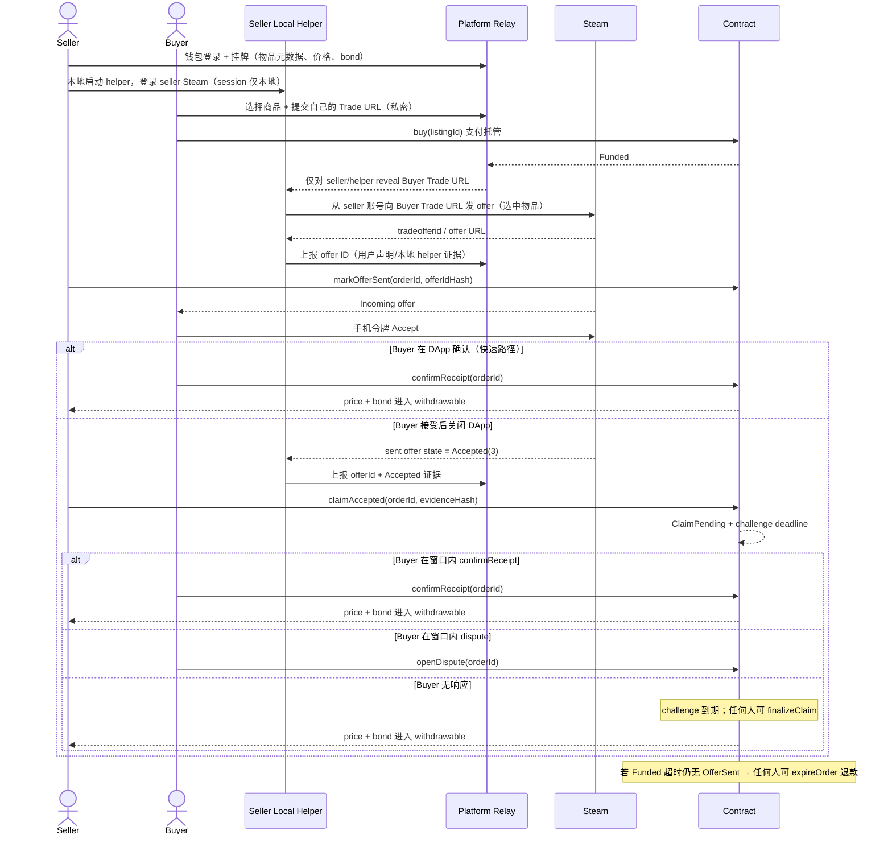

# Stage 0 Spec · 卖家本地 Helper 登录态发报价

**状态**：Steam 链路已验证（Plan A Go，2026-11-03）；结算兜底待 S1/S2 · **版本**：v0.5 · **Owner**：R3（Steam/Relay）+ R2（合约） · **执行日**：2026-11-03 · **阻塞**：S1 与 SPEC-1/2

> 目标：验证 **Plan A**：卖家在本地运行 helper，用**自己的 Steam 登录态**直接向买家的 Trade URL 发 offer；买家在 Steam 手机接受，再在 DApp 确认。平台不保存卖家 Steam 会话、不托管饰品；饰品始终在卖家库存里。
>
> v0.4（2026-11-03）：补充「买家接受后关闭 DApp」的结算兜底 —— helper 观察 Steam `Accepted(3)` → Seller `claimAccepted(evidenceHash)` → `ClaimPending` → 挑战窗口 → permissionless `finalizeClaim`；`confirmReceipt` 是快速路径。合约不读 Steam，也不二次扣款。
>
> v0.5（2026-11-03）：明确 **`markOfferSent` 不是放款条件**；卖家仅发 offer 不能拿钱。`Funded` 超时仍无 `OfferSent` → 任何人可 `expireOrder` 退款（需交易触发，不是合约自动执行）。

**相关 Spec**

| Spec | 文件 | 关系 |
|---|---|---|
| MVP Spec | [2026-11-01-dapp-project-mvp-spec.md](./2026-11-01-dapp-project-mvp-spec.md) | 上游：方向、范围、状态机摘要；Stage 0 结论回写 §3/§6/§9 |

> 本表只列当前 `specs/` 中已存在的 Spec。

---

## 0.1 实测结果（2026-11-03）

**Steam 链路 Go：卖家本地登录态 + 直接发指定物品可行。**

- 卖家/买家两个团队自有账号均已启用 Mobile Authenticator > 7 天；卖家库存公开，目标物品在可交易库存中。
- 卖家通过本地 helper QR 登录；refresh token 只保存到本地 `.steam-helper-session.json`（gitignore、600），**平台没有参与，也没有保存 session**。
- helper 校验了买家 Trade URL partner、卖家/买家不同账号、物品 asset/class/instance；然后从卖家账号发出指定物品的 offer。
- 实测 offer：**#9464202838**，初始 `status=pending`（Steam 要求卖家手机确认）。
- 卖家在 Steam 手机确认后，买家在 Steam 手机接受；物品到账，**无 trade hold**（两个账号均 >7 天）。
- helper 未自动确认卖家手机、未替买家接受；买家仍必须 Steam Accept。

**已验证**：本地 QR 登录态 / refresh token 复用、指定 asset 发 offer、卖家手机确认、买家接受、无 hold。helper 代码已内置 sent offer 状态轮询；本次测试没有把 `Accepted(3)` 后的链上 claim 接入。

**尚未验证（下一步 S1/S2）**：Relay 对买家 Trade URL 的 reveal/权限控制（本次 helper 直接读本地 `.env`，未经过 Relay）；链上 `markOfferSent`、DApp `confirmReceipt`，以及 **`Accepted(3)` → `claimAccepted` → 挑战窗口 → `finalizeClaim`** 的买家不确认兜底；`InEscrow(11)` 处理；失败路径/API 查询边界。

**实现**：`scripts/stage0/seller-helper.mjs`；运行 `npm run stage0:helper`（扫码）或 `npm run stage0:helper -- --send --no-wait`（已保存登录态直接发）。本地 session/QR/`.env` 均不入库。

> ⚠️ `scripts/stage0/` **只是 Stage 0 的演示/复现参考，不是 S1/S2 DApp 的 helper 实现**。它没有 Relay 鉴权、合约集成、证据上传、加密、UI、测试和失败恢复，不能直接复制/导入到产品代码；详见 `scripts/stage0/README.md`。

---

## 0. 结论先行

1. **官方 API 不能代创建/接受 trade offer**；OpenID/API key 不够。Plan A 使用卖家**本地登录态**（Steam session）创建 offer，是未官方接口；平台本身不持有这个会话。
2. **平台不托管饰品**：饰品一直在卖家库存；helper 只代表卖家发 offer。平台也不保存卖家 Steam 密码/会话。
3. **买家必须在 Steam 接受 offer**（手机令牌），平台不能替代；App 可以展示 offer 链接，但 Accept 由买家完成。
4. 卖家 helper 发 offer 可能触发 **Steam Guard 手机确认**；如果需要，卖家在手机上确认，不能绕过。
5. 为了防止「卖家已发、买家却超时退款」，卖家在 helper 创建 offer 后，用**自己的钱包**在链上 `markOfferSent(orderId, offerIdHash)`；**mark 本身不放款**。`confirmReceipt` 是快速结算，`claimAccepted` + 挑战窗口 + `finalizeClaim` 是买家不确认的兜底。
6. 如果 helper 无法在无平台会话/无卖家手动 Steam 的情况下发 offer，当天记录并降级为**卖家手动发送**或明确标注的 mock；不伪造。
7. **买家接受后不确认不是死局**：helper 观察 `Accepted(3)` 后，Seller `claimAccepted(evidenceHash)` → `ClaimPending`；买家在挑战窗口内可 `confirmReceipt` 或 `dispute`；窗口结束无争议，任何人可 `finalizeClaim` 放款。`InEscrow(11)` 不算最终交付；合约不读 Steam，也不二次扣款。
8. **没有 OfferSent 的退款**：`Funded` 超时仍无 `OfferSent` → 任何人可 `expireOrder`，本金退 Buyer、bond 退 Seller。合约不会自己定时执行，需用户/keeper 触发；这不是“卖家 mark 后打钱”。

---

## 1. 范围与非目标

### In scope

- 卖家本地 helper 的 Steam 登录会话（本地，不经过平台）。
- 卖家公开库存/物品字段校验。
- 买家 Trade URL 的解析、SteamID64 推导、付款后对卖家/helper 的授权 reveal。
- helper 从卖家账号向买家 Trade URL 发 offer，选择正确物品。
- 买家 Steam 手机接受；状态/暂挂/到货记录。
- 卖家 `markOfferSent`、`confirmReceipt` 与买家不确认时的 `claimAccepted`/挑战/`finalizeClaim` 兜底设计（合约实现 S1/S2）。
- 失败降级：helper 离线、会话过期、买家不接、Steam Guard、错误物品。

### Out of scope

- 平台后端保存卖家/买家 Steam 会话（账号托管；不做）。
- 平台 Bot 先收饰品（custody；不做）。
- 自动绕过 Steam Guard、自动接受买家 offer。
- 完整合约/前端/实验（SPEC-1/2/3）。
- 真实货币/贵重饰品；只用团队自己的低价值物品。

---

## 2. 准确流程

### 2.1 步骤与责任

| # | 动作 | 谁 | 凭证/数据 | 信任边界 |
|---|---|---|---|---|
| 1 | 挂牌 | Seller | 物品字段、价格、bond | 链上/Relay |
| 2 | 本地登录 Steam | Seller + Helper | Steam 会话只在本机 | **平台不保存** |
| 3 | 提交 Trade URL | Buyer | Buyer Trade URL（secret） | Relay 加密保存 |
| 4 | 支付 | Buyer | `buy` price | 链上 escrow |
| 5 | Reveal buyer URL | Relay → Seller/Helper | 仅该卖家；Funded 后 | 不公开/不上链 |
| 6 | 发 offer | Helper（seller 账号） | 选中 seller 物品，发给 buyer URL；拿 offer ID | 未官方接口；卖家本地会话 |
| 7 | 卖家标记 | Seller 钱包 | `offerIdHash = keccak256(bytes(tradeofferid))` | 链上用户声明 |
| 8 | 买家接受 | Buyer 手机 | Steam Guard 令牌 | Steam 事实；平台不验证 |
| 9 | 买家确认（快速路径） | Buyer 钱包 | `confirmReceipt` | 与 claim 二选一；终局不可撤销 |
| 10 | 买家不确认 → 卖家 claim | Helper + Seller 钱包 | helper 观察 `Accepted(3)`；`claimAccepted(evidenceHash)` | 链下证据声明；合约不验证 Steam |
| 11 | 挑战/自动放款 | Buyer / 任何人 | 窗口内 `confirmReceipt`/`dispute`；超时 `finalizeClaim` | 挑战窗口是买家对假 claim 的否决权 |

> **卖家必须先 markOfferSent 再让买家去接受**（或至少在接受前完成）：否则在 `Funded` 状态下买家可能通过超时退款拿走本金。UI 要把“helper 已发 → 卖家签名 markOfferSent → 通知买家接受”做成强制顺序。**`markOfferSent` 本身绝不能触发放款**——它只是“已发 offer”的声明；否则卖家可以在买家未接受、物品未转移时拿走 escrow。买家接受后即使关闭 DApp，helper 的 `Accepted(3)` 观测 + seller claim + 挑战窗口仍可结算；买家在窗口内仍可确认或争议。

---

## 3. 架构与接口

### 3.1 角色/组件

- **Seller Local Helper**：跑在卖家本机；用卖家自己的 Steam 登录态；从平台拿到已付款订单的 Buyer Trade URL；创建 offer；上报 offer ID；不把 session 发给平台。可以是一个 Node 进程/桌面小工具。
- **Platform Relay**：挂牌、订单、Buyer Trade URL 加密保管与授权 reveal、offer 证据；**不保存卖家 Steam 会话、不托管饰品**。
- **Contract**：escrow、`buy`、`markOfferSent`、`confirmReceipt`、`claimAccepted`/`finalizeClaim`、退款/中止/争议、pull payment。
- **Steam**：物品与 offer 的事实；买家手机接受。

### 3.2 后端接口（建议）

| 方法 | 路径 | 权限 | 作用 |
|---|---|---|---|
| POST | `/orders/:id/buyer-trade-url` | Buyer（钱包签名） | 提交 Buyer Trade URL；加密保存 |
| GET | `/orders/:id/buyer-trade-url` | Seller/Helper（钱包签名/配对令牌） | 仅 Funded 后返回；审计；不缓存 |
| POST | `/orders/:id/helper-offer` | Seller/Helper | 上报 `{tradeofferid, offerUrl}`；平台只做格式/一致性校验 |
| POST | `/orders/:id/helper-accepted` | Seller/Helper | 上报 `{tradeofferid, state: 3, observedAt}`；存为私有证据并计算 `evidenceHash`；不上链原始凭证 |
| POST | `/orders/:id/evidence` | Buyer/Seller | 上传私有证据（offer/trade history 截图） |
| GET | `/orders/:id` | Buyer/Seller | 订单状态与可见数据 |

- Buyer Trade URL 是 bearer secret：加密、短保留、只在 Funded 后给该卖家/helper；不上链、不写日志、终态清除。
- Helper 通过钱包配对/一次性配对码认证为 seller；平台不接收 Steam 密码/会话。
- `helper-offer` 只说明“用户/helper 声称发了 offer”；`helper-accepted` 只说明“helper 观察到 state=3”，都不是 Steam 的链上证明，仍由挑战/仲裁复核。
- `ClaimPending` 开始时 Relay/UI 要通知 Buyer；挑战窗口必须对买家可见，否则“不反对”不等于知情。

### 3.3 链上接口（建议，SPEC-1 定稿）

| 函数 | 调用者 | 作用 |
|---|---|---|
| `buy(listingId)` | Buyer | 支付，进入 Funded |
| `markOfferSent(orderId, offerIdHash)` | Seller 钱包 | 记录 seller 的发送声明；进入 OfferSent |
| `confirmReceipt(orderId)` | Buyer | **快速结算路径**；进入 Completed |
| `claimAccepted(orderId, evidenceHash)` | Seller 钱包 | 仅 OfferSent；记录 `Accepted(3)` 证据声明；进入 ClaimPending |
| `finalizeClaim(orderId)` | 任何人 | 仅 ClaimPending 且挑战窗口已过；进入 Completed，放款给 Seller |
| `claimRefund(orderId)` | Buyer | 仅 Funded 且超时未 OfferSent；本金退回 |
| `expireOrder(orderId)` | 任何人 | 仅 Funded 且超时未 OfferSent；本金退 Buyer、bond 退 Seller；permissionless |
| `abortBySeller(orderId)` | Seller | 仅 Funded；退款/中止 |
| `openDispute` / `resolveDispute` | Buyer/Seller / Arbiter | ClaimPending/OfferSent 的交付争议；仲裁 |

- `offerIdHash = keccak256(bytes(tradeofferid))`；`evidenceHash = keccak256(证据 JSON)`；链上不存完整 Trade URL/offer URL，也不存 Steam 原始凭证。
- 建议状态：`Active → Funded → OfferSent → ClaimPending → Completed`（`Funded` 超时无 offer 可 `expireOrder` → `Refunded`；另 Cancelled/Disputed，SPEC-1 冻结）。
- `claimAccepted` 是 Seller 的链下证据声明；只有 Steam `Accepted(3)` 才能作为依据，`InEscrow(11)` 不算最终交付。Buyer 在挑战窗口内仍可 `confirmReceipt` 或 `openDispute`；窗口前不能 `finalizeClaim`。
- helper 只负责观察并上报；`claimAccepted` 仍需 Seller 钱包签名。完全无人值守需要受限委托密钥或可信 verifier/bot（P2），不在 Plan A。
- 是否允许买家从 Funded 直接确认（卖家忘记 mark）由 SPEC-1 定；建议允许并强警告，避免卡死。
- `markOfferSent` 本身**不放款**；`Funded` 超时无 `OfferSent` 时任何人可 `expireOrder`。退款需要主动调用，不是合约自动执行；可由 buyer/helper/keeper 触发。
- 失败路径原则：买家本金优先；未验证的用户声明不自动没收 seller bond；争议处理实际交付瑕疵。**合约不读 Steam，也不从买家钱包二次扣款。**

### 3.4 Steam API 事实

- 无官方 `CreateTradeOffer` / `AcceptTradeOffer`；`GetTradeOffers` / `GetTradeOffer` / `GetTradeHistory` / `GetTradeOffersSummary` 是查询，且需要对应账号的 key/会话。
- Plan A 的“登录态”在**卖家本地 helper**，不是平台；helper 使用未官方 web session 接口；平台不保存。
- 买家仍必须 Steam Accept；卖家 helper 发 offer 可能需要 Steam Guard 手机确认。
- 报价状态码（如 2 Active / 3 Accepted / 9 CreatedNeedsConfirmation / 11 InEscrow）：**3 才是 Accepted；11 不是 3**。P0 不把 11 当已收货。平台无用户 key/会话时不自动查询。
- helper 用 seller 本地 session 观察 sent offer；观察到 `Accepted(3)` 后上报私有证据，链上 `claimAccepted` 由 Seller 钱包签名。平台不能替卖家查询或 claim；这也不是 Steam 的链上证明。

---

## 4. 数据与隐私

- **卖家 helper 会话**：只在本机；不写入 repo、聊天、`.env`、截图；session 文件放本地并 gitignore；helper 退出/注销即可失效。
- **Buyer Trade URL**：加密存储；仅 Funded 后 reveal 给该订单的 seller/helper；不公开、不上链；最终状态后删除/锁定。
- **offer ID**：链上只存 hash；完整 offer URL/截图放私有证据存储。
- **Buyer SteamID**：用于匹配/证据；最小化收集；公开文档打码。
- **不让平台后端保存用户 Steam 密码/会话**；如果做，就是账号托管，必须另行 threat model（不在 Plan A）。
- 不使用真实贵重饰品；demo 低价值物品；视频遮挡账号信息。

---

## 5. 测试计划

### 5.1 准备

- A = 卖家账号（有目标物品）；B = 买家账号；两个账号均已启用 Mobile Authenticator **> 7 天**（你现在已满足）。
- A 的库存公开；测试物品无冷却、可交易；准备 2 件备用。
- B 提供自己的 **Trade URL**（私密；不是 A 的，也不是库存链接）。
- 卖家 helper：在 A 的本机登录 Steam；session 不交给平台。
- 可选临时 Steam Web API key：只测试查询；不写 repo；测试后 revoke。

### 5.2 测试用例

| ID | 测试 | 期望/通过标准 | 证据 |
|---|---|---|---|
| T0 | 账号/物品/helper 准备 | A/B 均 >7 天；A 库存公开；物品无冷却；helper 能本地登录 A；B 提供 Trade URL | 脱敏截图/记录 |
| T1 | 库存/物品字段 | 读 A 库存，命中 asset；字段完整（asset/class/instance/marketHashName/inspectLink） | JSON 摘要（脱敏） |
| T2 | Buyer Trade URL 校验 | 解析 partner/token；由 partner 推导 B 的 SteamID64；格式/权限测试 | 解析记录 |
| T3 | Reveal 权限 | 未 Funded：拒绝；Funded 后仅该 seller/helper 能拿到 B 的 Trade URL；不公开/不写日志 | API 测试记录 |
| T4 | Helper 发 offer | helper 用 A 的登录态，向 B 的 Trade URL 发送**该物品**的 offer；记录 `tradeofferid`/offer URL；B 能看到；A 的 item 仍在 A 库存直到接受 | offer ID、截图 |
| T5 | 买家接受 | B 在 Steam 手机用令牌 Accept；记录 state（2/3/9/11）；预期 clean（两者 >7）无 hold；核对物品/卖家 | 截图、时间线 |
| T6 | 卖家标记 | 用本地模拟/合约调用 `markOfferSent(orderId, offerIdHash)`；offerIdHash 一致；UI/Relay 记录 | 测试记录 |
| T7 | API 查询边界（可选） | 用临时 key 调 GetTradeOffer/GetTradeOffers/GetTradeHistory/GetTradeOffersSummary；记录能看到哪些 offer；平台无用户 session 不能自动查询 | 响应摘要（脱敏） |
| T8 | 失败/降级 | helper 离线、会话过期、B Trade URL 错误、物品被交易/冷却、B 拒绝/不接、Steam Guard 失败；回退卖家手动/mock | 错误记录 |
| T9 | asset_id 变化 | 交易前后 A/B inventory 的 asset_id 变化；不能做永久 NFT/链上 ID | before/after |
| T10 | 隐私/hash | 平台无 A 的 Steam session；B 的 Trade URL 不落日志/链上；offer hash 一致；无 secrets | 审计记录 |
| T11 | Go/No-Go | helper 能发、B 能接受、A 能 mark、claim/finalize 兜底可用、平台无会话/托管；否则记录降级 | 签字 |
| T12 | 买家接受后不确认（待 S1/S2） | helper 观察 state=3；Seller `claimAccepted` 进入 ClaimPending；窗口内 Buyer 可 confirm/dispute；窗口前 `finalizeClaim` 必须 revert；超时 finalize 成功；`InEscrow(11)` 不触发自动 claim | 合约测试 + 时间线 |
| T13 | Funded 超时无 OfferSent（待 S1/S2） | deadline 前 `expireOrder` 必须 revert；deadline 后任何人可调用，本金退 Buyer、bond 退 Seller；已有 OfferSent 不能 expire | 合约测试 |

> T4 是关键：**卖家本地登录态能否在不把 session 交给平台的情况下，创建到买家 Trade URL 的 offer**。若 helper 登录/发 offer 必须触发无法绕过的手机确认，记录为“需卖家手机确认”，仍可用但不算全自动；不能伪造。

### 5.3 记录模板

| 字段 | 记录 |
|---|---|
| Test ID / 日期 | T4 / 2026-11-03 |
| A/B | SteamID64（内部；文档/视频打码） |
| 物品 | asset_id / class_id / instance_id / market_hash_name / inspect_link |
| Helper | 登录方式（本地 session/二维码）；是否触发 Steam Guard；session 是否只在本地 |
| Buyer URL | partner/token 已验证（token 打码） |
| offer | tradeofferid / offerUrl / offerIdHash |
| 状态 | state 值 + 时间；是否 hold |
| 证据 | 脱敏截图/trade history |
| 结论 | pass/fail + 对 P0 的影响 |

---

## 6. Go / No-Go

### Go 条件

- T0–T5 通过：两个账号均 >7 天；helper 能本地登录 A；能向 B 的 Trade URL 发正确物品的 offer；B 能接受。
- **2026-11-03 实测：T0–T5 通过** —— offer `#9464202838`，`pending` → 卖家手机确认 → 买家接受；物品到账、无 hold；平台未参与、未保存 session。
- T6/T7/Relay reveal/链上 `markOfferSent`/DApp `confirmReceipt` 尚未在本次测试中覆盖，进入 S1/S2。
- T12（买家接受后不确认 → `claimAccepted`/`finalizeClaim` 兜底）与 T13（Funded 无 OfferSent → `expireOrder` 退款）尚未覆盖，进入 S1/S2；`confirmReceipt` 是快速路径，claim 是兜底，不是二次扣款。
- T10 部分通过：seller session 在本机、平台无 session；Relay 的 buyer URL 权限控制待 S1/S2。
- 结论：P0 固定为 **卖家本地 helper + buyer Trade URL + buyer Accept + DApp confirm/claim finalize + 无 offer expire 退款**；平台不托管饰品/会话。

### 条件不成立时

| 阻塞 | 调整 |
|---|---|
| Helper 登录/发 offer 必须把 session 交给平台 | 不做；降级为卖家手动发送，或明确标注的 mock；平台不保存用户会话 |
| Helper 发 offer 必须无法绕过的手机确认 | 记录“需卖家手机确认”；仍可 demo，但不算全自动；报告写清 |
| B 不接受/不接受 buyer URL | 换账号/手动；保留退款路径；mock 兜底 |
| Trade hold | 检查账号 >7/物品冷却；换物品/账号；不行则 mock 标注 |
| 官方 API 能力与文档不符 | 以实测为准；更新 spec/报告 |

### 交付物

- 填好的测试报告（offer ID/state/时间/是否 Steam Guard/hold）。
- Helper 的本地登录/发 offer 证据（脱敏）；平台无 session 的证明。
- 买卖双方账号/物品准备记录；Buyer Trade URL 权限测试。
- Go/No-Go；若 No-Go，写明手动/mock 降级。
- 更新主 MVP spec、SPEC-1（`markOfferSent`/`confirmReceipt`/退款）、SPEC-2（买家 URL vault/helper 配对/Trade Room）。

---

## 7. 安全与隐私

- **Helper session 只在卖家本地**；不要上传、提交、截图、发聊天。Helper 以最小权限运行；退出即失效；本地 session 文件 gitignore。
- **Buyer Trade URL 是 bearer secret**：加密、仅 Funded 后给该 seller/helper、不写日志、终态清除；平台不能公开。
- **不保存用户 Steam 密码/移动令牌**；不绕过 Steam Guard；不自动接受买家 offer。
- Helper 使用未官方 Steam session 接口，存在 ToS 风险；报告中明确；仅课程 demo，不做商业运营。
- 卖家 `markOfferSent` / `claimAccepted` 是链上用户/helper 声明；**`markOfferSent` 不放款**；买家 `confirmReceipt` 是快速结算；`claimAccepted` + 挑战窗口 + `finalizeClaim` 是买家不确认的兜底；都不是 Steam 验证。合约不读 Steam，也不二次扣款。
- `Funded` 超时无 `OfferSent` 只能 `expireOrder` 退款；不能因为 seller 发了 offer 就放款。`expireOrder` 是 permissionless，但需要有人发交易。
- 只有 `Accepted(3)` 可作为 claim 依据；`InEscrow(11)` 不自动 claim。`claimAccepted` 的 `evidenceHash` 对应私有证据（offer ID、state、时间、trade history），完整凭证不上链。
- 只用团队自己的低价值物品；不碰真实货币；视频脱敏。

> 外部 API 行为以 Stage 0 实测为准；本文只关联 `specs/` 内的 Spec，不列外部信息来源。

---

*Stage 0 只回答：卖家本地登录态 helper 能否发出 offer、买家能否接受、平台能否不持有 session/饰品；买家不确认时的 `claimAccepted`/`finalizeClaim` 兜底只在本文定方向，合约实现与测试在 S1/S2/SPEC-1。*
