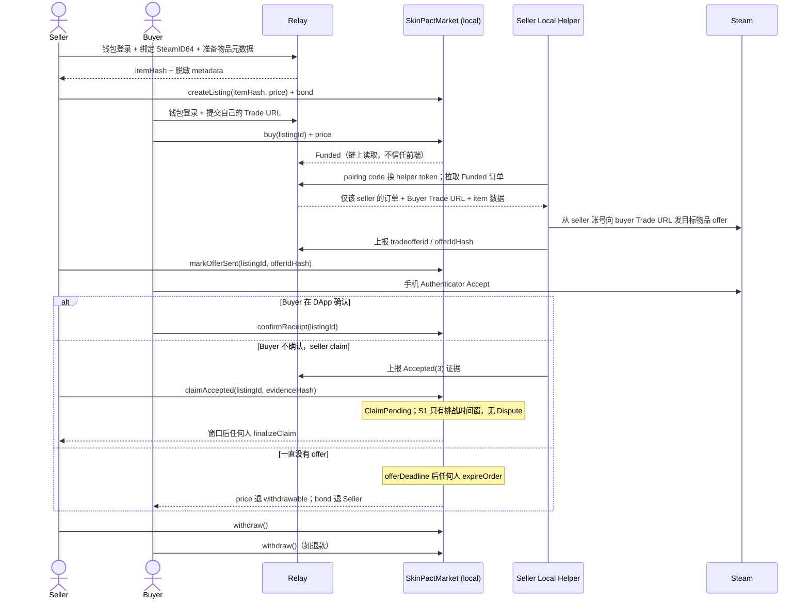
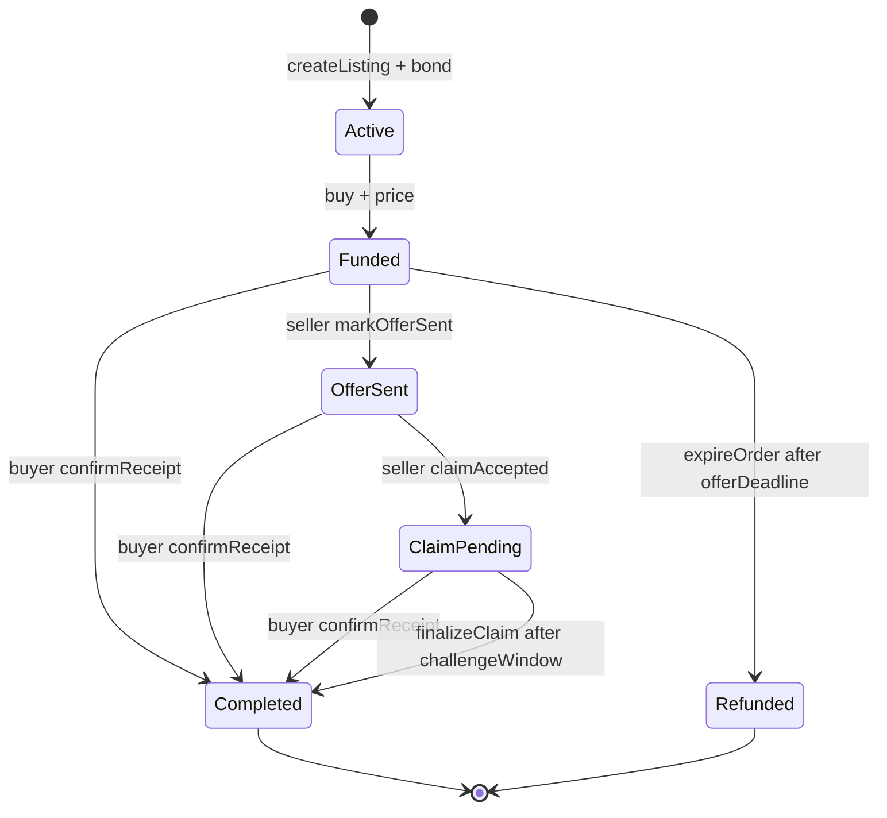

# Stage 1 Spec · 本地链垂直切片（SkinPact S1）

**状态**：已 review · 本地实现完成（真实 Steam helper / 手动 UI 验收待执行） · **版本**：v0.2 · **Owner**：R2（合约）+ R3（Relay/Helper/前端） · **执行**：2026-11-03–2026-11-04 · **目标退出**：2026-11-04 18:00 · **课程截止**：2026-11-08 23:59 · **团队人数**：`{N}`（4–5）

> 目标：在 **Hardhat 本地链** 跑通「卖家挂牌 → 买家付款 → Relay 授权 reveal Buyer Trade URL → 本地 helper 发 Steam offer → 卖家 mark → 买家 confirm / 卖家 claim / 无 offer expire」的垂直切片。
>
> S1 是**本地、受控账号**的集成切片：只部署本地区块链，不部署 Sepolia，不实现 Dispute/Arbiter。S1 合约**不能作为公开 testnet 版本**；S2 补齐争议与中止后再部署。`scripts/stage0/` 仅作参考，S1 helper 重新实现。
>
> v0.2（2026-11-03）实现进度：合约/Relay/helper/web 已落地；`npm test`（1 + 20 + 10 + 8 = 39）与 `npm run e2e:local` P1–P4、`npm run build` 通过。E2E 的 Steam 传输为**明确标注的 mock**；S1 helper 真实 Steam offer 与手动 UI 走查尚未执行，不能将 mock 记为真实 Accept。

**相关 Spec**

| Spec | 文件 | 关系 |
|---|---|---|
| MVP Spec | [2026-11-01-dapp-project-mvp-spec.md](./2026-11-01-dapp-project-mvp-spec.md) | 上游：范围、状态机、资金流、S1 出口；本文细化 §6 的 S1 行 |
| Stage 0 | [2026-11-02-stage-0-steam-tradeoffer-spec.md](./2026-11-02-stage-0-steam-tradeoffer-spec.md) | 已验证 Steam helper 登录态/发 offer；S1 在其上接入 Relay 与合约 |

---

## 1. 目标与边界

### 1.1 S1 必须证明的事

| ID | 要证明 | 最小证据 |
|---|---|---|
| A1 | 卖家可锁 bond 挂牌，买家可精确支付 price，状态与金额正确 | 本地链交易 + 合约测试 |
| A2 | Buyer Trade URL 只在 `Funded` 后 reveal 给该订单的 seller/helper | Relay 权限测试 + 日志/DB 检查 |
| A3 | 本地 helper 用**自己的 Steam 登录态**从卖家账号向正确买家发正确物品 offer | 一次真实 Steam offer + 脱敏记录 |
| A4 | `markOfferSent` 只是声明，**不放款**；buyer confirm、seller claim/finalize、无 offer expire 三条路径可走通 | 合约测试 + 本地 E2E |
| A5 | 前端可用 MetaMask 完成 create/buy/order 动作，状态以链上为准 | 手动 UI 检查 + build |
| A6 | 全仓测试可重复、无 Trade URL/Steam session 泄露 | `npm test` 绿 + 安全测试 |

### 1.2 In scope

- 合约：`createListing`、`buy`、`markOfferSent`、`confirmReceipt`、`claimAccepted`、`finalizeClaim`、`expireOrder`、`withdraw`。
- Relay：钱包登录、卖家 SteamID/库存/元数据、Buyer Trade URL 加密 vault、helper 配对、offer/证据上报、链上状态校验。
- Helper：QR 登录、从 Relay 取 Funded 订单、发 offer、观察 `Accepted(3)`、上传证据；**不签链上交易**。
- 前端：钱包连接、本地市场、卖品、最小订单页（Trade Room 雏形）、withdraw。
- 测试：合约单测/状态不变量、Relay 权限/加密测试、helper 单元测试、本地链三路径 E2E、一次真实 Steam 手动测试。

### 1.3 Out of scope（S1 不做）

- Sepolia 部署/verify、E2E 在 testnet 跑；S2 做。
- `Disputed`、Arbiter、`openDispute`/`resolveDispute`、`abortBySeller`、seller cancel listing。
- `OfferSent` 后买家一直不接受/offer 过期的退款路径；S1 会卡住，S2 补。
- `InEscrow(11)` 的自动/延迟结算；S1 只记录为 held，不 claim。
- helper 自动签 `claimAccepted`、自动提现、自动同意卖家手机确认。
- NFT/平台币、实验 E1–E3、完整 Dashboard/Arbiter UI、移动端、桌面打包、Steam OpenID。
- 真实货币/贵重饰品；S1 只用团队账号和低价值物品。

---

## 2. 端到端流程（S1）



### 2.1 责任边界

| 组件 | 负责 | 不负责 |
|---|---|---|
| Contract | 资金托管、状态、bond、pull payment | Steam 交付、Trade URL、证据真实性 |
| Relay | 元数据、加密 Buyer URL、授权 reveal、offer/证据存储、链上状态校验 | 资金、Steam session、饰品托管 |
| Helper | 本地 Steam 登录态、发 offer、观察 Accepted、上报证据 | 链上签名/提现、平台托管、自动接受买家 offer |
| Frontend | 钱包交互、链上读写、展示 Relay 元数据/证据 hash | 替用户签交易、展示/保存完整 Buyer URL 到前端 |

> `listingId` 在 S1 同时作为 `orderId`；一个 listing 只成交一次。不要另建 order ID 映射。

---

## 3. 合约（S1 冻结接口）

### 3.1 状态机



- S1 **没有** `Disputed`/`Cancelled`；`OfferSent` 后如果买家不接受且卖家不 claim，资金会停在合约里。S1 只在受控本地 demo 使用，S2 必须补退款/争议后才能上 Sepolia。
- `ClaimPending` 的挑战窗在 S1 只是买家确认的宽限期，不是真正的争议机制。

### 3.2 参数与数据结构

| 项 | S1 默认 | 说明 |
|---|---|---|
| `maxPrice` | `0.1 ether` | create 时强制上限；testnet 安全阀 |
| `minBond` | `0.001 ether` | `bond = max(minBond, price × 10%)` |
| `bond` | 见上 | `createListing` 的 `msg.value` 必须精确等于 bond |
| `offerWindow` | 10 分钟（本地） | `buy` 时记录 `offerDeadline = now + offerWindow`；部署可配 |
| `challengeWindow` | 5 分钟（本地） | `claimAccepted` 时记录挑战截止；部署可配 |
| 平台费 | 0 | 无费率、treasury、owner 提款 |
| 网络 | Hardhat 31337 | S1 不部署 Sepolia |

```solidity
enum Status { None, Active, Funded, OfferSent, ClaimPending, Completed, Refunded }

struct Listing {
    address seller;
    address buyer;
    uint256 price;
    uint256 bond;
    bytes32 itemHash;
    bytes32 offerIdHash;
    bytes32 evidenceHash;
    uint64 offerDeadline;
    uint64 challengeDeadline;
    Status status;
}
```

- `itemHash = keccak256(UTF-8(canonical JSON))`，字段固定为 `sellerSteamId, assetId, classId, instanceId, marketHashName`；由 `shared/` 统一实现，Relay 和 helper 必须一致。
- `offerIdHash = keccak256(bytes(tradeofferid))`；完整 offer ID 只进 Relay 私有证据。
- `evidenceHash = keccak256(UTF-8(canonical JSON(evidence)))`；链上只存 hash，完整证据加密存 Relay。
- `activeItemHash[itemHash]` 防止同一物品被重复挂牌；终态清除（S1 无 seller cancel）。
- `usedOfferIdHash[offerIdHash]` 防止同一 offer 被复用到多个订单。

### 3.3 函数

| 函数 | 调用者 | 前置/效果 |
|---|---|---|
| `createListing(bytes32 itemHash, uint256 price) payable` | Seller | price ∈ (0, maxPrice]；itemHash 非 0 且未活跃；`msg.value == quoteBond(price)`；锁 bond；返回 `listingId` |
| `buy(uint256 listingId) payable` | Buyer | `Active`；buyer ≠ seller；`msg.value == price`；记录 buyer、`offerDeadline`；进入 `Funded` |
| `markOfferSent(uint256 listingId, bytes32 offerIdHash)` | Seller | `Funded`；`block.timestamp < offerDeadline`；hash 非 0 且未用过；进入 `OfferSent`；**不增加 withdrawable** |
| `confirmReceipt(uint256 listingId)` | Buyer | 允许 `Funded`（卖家忘记 mark，UI 强警告）、`OfferSent`、`ClaimPending`；price + bond 记入 seller withdrawable；进入 `Completed` |
| `claimAccepted(uint256 listingId, bytes32 evidenceHash)` | Seller | 仅 `OfferSent`；evidenceHash 非 0；进入 `ClaimPending`，记录 claim 时间和 challengeDeadline；**不放款** |
| `finalizeClaim(uint256 listingId)` | 任何人 | 仅 `ClaimPending` 且 `block.timestamp >= challengeDeadline`；price + bond 记入 seller withdrawable；进入 `Completed` |
| `expireOrder(uint256 listingId)` | 任何人 | 仅 `Funded` 且 `block.timestamp >= offerDeadline`；price 记入 buyer withdrawable，bond 记入 seller withdrawable；进入 `Refunded` |
| `withdraw()` | 任何有余额者 | pull payment；CEI + `nonReentrant`；只转 `withdrawable[msg.sender]` |
| `quoteBond(uint256 price) view` | 任何人 | 计算 bond；供前端显示 |
| `getListing(uint256) view` | 任何人 | 返回 struct；前端每次动作前从链上重读 |

- 精确 `msg.value`：多付/少付都 revert；不存在“多冻的钱”。
- 禁止自买；`buy` 只允许 Active；重复买/已成交买必须 revert。
- `confirmReceipt` 在 `Funded` 也允许，是为了防止“卖家发了 offer 但忘记 mark”把买家卡死；任一确认都是终局，UI 必须要求买家确认已收到 Steam 物品。
- `claimAccepted` 的 evidenceHash 是 Seller/helper 的链下声明；S1 不做链上验证。S2 用挑战/争议复核。
- `expireOrder` 是 permissionless，但**需要有人发交易**，不是合约定时器；截止前调用必须 revert。
- 合约不实现 `receive`；直接转账 ETH 会 revert。

### 3.4 资金与退款（S1 实际行为）

| 场景 | Buyer price | Seller bond | 触发/终态 |
|---|---|---|---|
| `Funded`，offerDeadline 前 | 仍在 escrow | 仍在 escrow | 等待 offer / buyer confirm |
| `Funded`，deadline 后仍无 mark | **退回 buyer withdrawable** | **退回 seller withdrawable** | 任何人 `expireOrder` → `Refunded` |
| `Funded`，买家直接 confirm（卖家忘 mark） | 给 seller | 给 seller | buyer `confirmReceipt` → `Completed` |
| `OfferSent`，买家 confirm | 给 seller | 给 seller | buyer `confirmReceipt` → `Completed` |
| `OfferSent`，seller claim 后挑战期结束 | 给 seller | 给 seller | `claimAccepted` → `finalizeClaim` → `Completed` |
| `ClaimPending`，买家在窗口内 confirm | 给 seller | 给 seller | buyer `confirmReceipt` → `Completed` |
| `OfferSent`，buyer 不接受且 seller 不 claim | **S1 无退款路径，资金停留** | 停留 | S2 补退款/争议；S1 仅本地受控 demo |
| `InEscrow(11)` | 不自动退 | 不自动退 | helper 只记录 held；S2 处理 |
| Completed/Refunded 后 | 不可再退款 | 不可再退款 | 终态 |
| 多付/错金额 | 交易 revert | 交易 revert | 精确金额检查 |
| gas | 不退 | 不退 | 由交易发起人承担 |

- 退款/结算都是**记账**，不是 push；收款人必须 `withdraw()`。这个差异要写进 UI/README。
- `markOfferSent` 不放款；只有 buyer confirm 或 claim finalize 才 release escrow。
- **顺序要求**：helper 发 offer 后，卖家应立刻 `markOfferSent`；UI 明确提示买家“等卖家 mark 后再接受”。如果买家先接受、卖家又错过 deadline，买家仍可 `expireOrder`（链上无法证明已收货），这是 S1 的受控账号前提；S2 用证据/争议处理。
- S1 无 `abortBySeller`、无 `claimRefund`；统一用 `expireOrder`（buyer 也可以直接调用这个 permissionless 函数）。
- S1 无 seller cancel listing；`Active` 的 bond 会一直锁到成交或后续 S2 的 cancel 逻辑。

### 3.5 不变量与安全要求

- 合约余额 = 所有未终结订单的 `price + bond` + 所有人的 `withdrawable`（测试/不变量）。
- 终态后不重复结算；`confirmReceipt`/`finalizeClaim`/`expireOrder` 互斥。
- 无 owner/treasury/费率/暂停/升级函数；S1 合约参数 immutable。
- 使用 OZ `ReentrancyGuard`、custom errors、events、CEI、精确金额、角色校验。
- 关键事件：`ListingCreated`、`ListingBought`、`OfferMarked`、`ReceiptConfirmed`、`ClaimAccepted`、`ClaimFinalized`、`OrderExpired`、`Withdrawn`；seller/buyer/listingId 用 indexed。
- 单测必须覆盖所有 revert 分支；至少一个余额不变量测试。

---

## 4. Relay（S1 最小后端）

### 4.1 职责与信任边界

- Relay **不持有资金、不接收/保存卖家 Steam session、不托管饰品**。
- Relay 的订单状态以**链上 `getListing`**为准；前端/helper 上报的状态只能作为辅助。
- Buyer Trade URL 是 bearer secret：加密存储、授权 reveal、不写日志、终态删除。
- Relay 可读公开 Steam 库存；不保存用户 Steam 密码/移动令牌。

### 4.2 接口

| 方法/路径 | 权限 | 作用/关键校验 |
|---|---|---|
| `GET /health` | public | 存活/版本/链高度 |
| `POST /auth/nonce` | public | 返回域分隔 nonce（含 chainId、地址、过期时间） |
| `POST /auth/verify` | public | EIP-191 签名 → JWT；nonce 单次使用 |
| `POST /profiles/me` | JWT | 绑定钱包 → SteamID64（格式校验；S1 不做 Steam OpenID） |
| `GET /inventory/:steamId` | public | 只读公开库存并归一化；缓存；不再存 seller session |
| `POST /items/prepare` | Seller JWT | 校验物品属于该 SteamID，返回 `{item, itemHash, metadata}` |
| `GET /metadata/:itemHash` | public | 市场展示元数据；不返回 Trade URL |
| `POST /helper/pairing-code` | Seller JWT | 生成短时一次性配对码；只存 hash |
| `POST /helper/pair` | pairing code | 换 helper token（绑定 seller address）；一次性、限速 |
| `PUT /listings/:id/buyer-trade-url` | Buyer JWT | 解析 partner/token；listings 必须 Active，或 Funded 且链上 buyer 匹配；OfferSent/终态拒绝 |
| `GET /listings/:id/buyer-trade-url` | Seller JWT | 仅 `Funded` 且 seller 匹配；手动排障 fallback；不缓存、不写日志、不在 Web UI 展示 |
| `GET /helper/orders?status=funded` | Helper token | 该 seller 的 Funded 订单；返回 Buyer URL、buyerSteamId、item 数据；链上复核 seller/status |
| `POST /helper/listings/:id/offer` | Helper token | 上报 `{tradeofferId, offerUrl}`；链上必须 Funded 且 seller 匹配；存 hash/加密证据 |
| `POST /helper/listings/:id/accepted` | Helper token | 上报 `Accepted(3)` 证据；链上必须 OfferSent 且 `offerIdHash` 匹配；返回 evidenceHash |
| `GET /listings/:id/report` | Seller/Helper | 只返回 offerIdHash、evidenceHash、observed state；**不返回 Buyer URL** |
| 后台 watcher | Relay | 终态删除 Buyer URL；链上状态不一致时拒绝 reveal |

- Relay **不提供**买家自行读取别人 Trade URL 的接口；正常路径只走 helper。Seller UI 不显示完整 URL；S1 的 seller-only URL 接口只作为本地排障 fallback，不在 Web UI 暴露。
- 买家可在 `buy` 之前提交 URL；但如果最终不是该钱包购买，Relay 在 reveal 时发现链上 buyer 不匹配，拒绝提供。买家也可以在 Funded 后补交，直到 `OfferSent` 前。
- `GET /helper/orders` 的 Buyer URL 只放入响应体；不记录 query/body；helper 端也不落盘。

### 4.3 鉴权

- Web：`nonce + EIP-191` 钱包签名换 JWT（1h）；消息包含 `domain, address, chainId=31337, nonce, issuedAt`，防重放。
- Helper：卖家在 Web 生成 6 位一次性 pairing code（5 分钟、限速、hash 存储），helper 用它换 **scoped helper token**（8h、只属于该 seller、只可访问 `/helper/*`）。helper **不持有卖家私钥**，不能签合约交易。
- Helper token 存本地 `helper-session.json`（600、gitignore）；Steam session 另存，二者都不发给 Relay。
- JWT/helper token/配对码都不得写入日志。

### 4.4 Buyer URL vault

- 解析 Trade URL 的 `partner` 与 `token`；由 partner 推导 buyerSteamID64；格式非法直接 422。
- 存储：AES-256-GCM；`RELAY_ENCRYPTION_KEY` 来自本地 env；每条记录随机 IV；DB 只存 ciphertext/iv/tag。
- 访问检查顺序：认证 → 读取链上 listing → 校验状态 `Funded` → 校验 `listing.seller == 当前 seller/helper 的 seller` → 才解密返回。
- 终态（Completed/Refunded）由 watcher 删除记录；删除前有审计计数，但不存明文。
- 日志中间件对 `tradeUrl/token/authorization/cookie` 做 redaction；错误响应不回显请求 body。
- 更新 URL：Active/Funded 且未 OfferSent 允许覆盖；每次覆盖审计，不保留旧明文。

### 4.5 数据与链上一致性

- SQLite（`better-sqlite3`）+ 迁移；最小表：`profiles`、`metadata`、`buyer_urls`、`helper_pairings`、`helper_sessions`、`offers`、`evidence`、`nonces`。
- Relay 保存最小 listing 映射（seller、itemHash、buyer、状态缓存），但每次敏感操作前重新读链；缓存不得作为 reveal 依据。
- `metadata` 按 `itemHash` 存；前端从链上拿 listing，再用 hash 取 metadata。链上不存图片/大 JSON。
- 证据只存加密 blob + hash + observedAt；S1 不做 Arbiter 查询接口。

### 4.6 运行配置

- `RPC_URL`、`CONTRACT_ADDRESS`、`CHAIN_ID=31337`、`RELAY_ENCRYPTION_KEY`、`JWT_SECRET`、`WEB_ORIGIN`；全部 env，不提交真实值。
- CORS 只允许本地 web origin；基础 rate limit；TLS 不是本地必需，但 S2 部署必须。

---

## 5. Helper（S1 最小版）

### 5.1 启动与配对

1. 卖家在 Web 生成 pairing code。
2. helper 用 code 换 helper token；**不接收卖家私钥**。
3. helper QR 登录卖家 Steam（`steam-session`）；refresh token 仅存本地，600、gitignore。
4. helper 校验登录的 SteamID64 与 Relay profile 的 sellerSteamId 一致；不一致拒绝。
5. helper 轮询 `/helper/orders?status=funded`。

### 5.2 发 offer

- 每个订单校验：buyer Trade URL partner/token、buyerSteamId、seller≠buyer、item 的三元组（asset/class/instance）和 marketHashName。
- 用 `steam-tradeoffer-manager` 从卖家登录态向买家 Trade URL 创建 offer；只选目标物品，不加额外物品。控制台/README 明示：**卖家先 mark，买家再接受**，避免买家接受后被 expire 的竞态。
- 本地记录 `listingId → tradeOfferId`；重启后先查本地 ledger 和 Steam sent offers，避免同一订单重复发 offer。不能确定是否已发时，**暂停并提示人工核对**，不自动重发。
- 创建成功后向 Relay 上报 offer ID；控制台显示 `offerIdHash`，卖家在 Web 签名 `markOfferSent`。
- 不自动确认卖家手机 Steam Guard；不替买家接受；不把 session/token 发给 Relay。

### 5.3 状态观察与证据

| Steam state | helper 行为 |
|---|---|
| `2 Active` | 继续轮询 |
| `3 Accepted` | 上报 evidence，计算 `evidenceHash`；**不签链上交易** |
| `5/6/7/8 Expired/Canceled/Declined/InvalidItems` | 上报失败；S1 不 claim、不退款；等待人工/S2 |
| `9 CreatedNeedsConfirmation` | 提示卖家手机确认；继续观察 |
| `11 InEscrow` | 记录 held；**不 claim**；S2 处理 |
| 其他/未知 | 记录并暂停；不猜测 |

- 证据 canonical JSON 至少包含：`listingId, tradeOfferId, state:3, observedAt, sellerSteamId, buyerSteamId, items[]`；Relay 加密保存，返回 `evidenceHash`。
- Seller 在 Web 用该 hash 手动 `claimAccepted`；S1 不自动 claim。
- 日志遮挡 Trade URL token、Steam session、helper token、Steam 个人信息；不打印完整 URL。

### 5.4 失败处理

- Relay 不可达 / token 过期：重试并提示重新配对；不重发已确认的 offer。
- 物品被交易/冷却/不在库存：停止该订单并提示；不伪造 offer。
- 买家 URL 非法/与 buyerSteamId 不符：拒绝发 offer 并告警。
- helper 离线：S1 卖家可通过受保护的 seller-only Relay 接口取一次 Buyer URL，人工在 Steam 发 offer（不经过平台）；Web UI 不展示该 URL，S1 仍以链上 mark 为准；README 标注手动路径，不用 mock 冒充真实。

---

## 6. 前端（S1 最小可用）

### 6.1 技术/网络

- React + Vite + TypeScript + ethers v6；按 `shared/` 的 ABI 读合约。
- MetaMask，Hardhat 本地网络 `31337`；错误链提示切换/添加；所有关键动作后从链上重读，不做乐观更新。
- 金额用 `parseEther`/`formatEther`；价格、bond、withdrawable 分别显示。

### 6.2 页面与动作

| 页面 | 最小功能 |
|---|---|
| Market | 读链上 Active listings；按 itemHash 从 Relay 取 metadata；显示 price/bond/seller |
| Sell | 绑定 SteamID64；从 Relay 库存选物品；输入 price；显示 bond；`createListing` |
| Order/Trade Room | 提交/更新 Buyer URL；`buy`；seller `markOfferSent`；buyer `confirmReceipt`；seller `claimAccepted`；任何人 `finalizeClaim`/`expireOrder`；显示 deadlines/状态 |
| Header | 连接钱包、网络、withdrawable、`withdraw` |

- Buyer 的 Trade URL 输入框只在 Active/Funded 且未 OfferSent 显示；提交后提示“只有卖家 helper 可见”，前端不缓存明文。
- Seller 的标记动作显示 `offerIdHash`（来自 Relay report）和截止倒计时；“mark 不放款”写进确认文案。
- Buyer 页面显示“**等卖家 mark 后再接受 Steam offer**”；如果买家先接受、卖家未及时 mark，链上仍可能被 expire，S1 不做自动补救。
- Buyer confirm 必须勾选“我已在 Steam 收到物品”；终局不可撤销；`Funded` 直接 confirm 额外警告。
- Claim 按钮只有 Relay report 有 evidenceHash 时可用；显示挑战倒计时；S1 无 dispute 按钮。
- Expire 按钮仅在 `Funded` 且 deadline 后对任何人可见；说明 price 退 buyer、bond 退 seller，均需 withdraw；`OfferSent` 后隐藏。
- S1 不做 Arbiter/Dispute/Dashboard 完整页；Trade Room 可先用最小页面，S2 完善。

---

## 7. 测试与退出标准

### 7.1 合约测试

| 组 | 必须覆盖 |
|---|---|
| create | bond 公式、maxPrice、itemHash 重复、错误金额、事件 |
| buy | 精确 price、自买、重复买、状态/截止时间 |
| mark | 仅 seller、仅 Funded、deadline 前、hash 非 0/不重复、**不放款** |
| confirm | 仅 buyer、Funded/OfferSent/ClaimPending、重复确认、price+bond 记账 |
| claim/finalize | 仅 seller、仅 OfferSent、evidence 非 0、窗口前 finalize revert、窗口后任何人可 finalize |
| expire | deadline 前 revert、deadline 后任何人可调用、OfferSent 后不可 expire、退款金额 |
| withdraw | pull、零余额、重复、CEI/重入保护 |
| invariant | 合约余额 = escrow + withdrawable；无重复结算 |

### 7.2 Relay / helper 测试

- URL 未 Funded 不可 reveal；非该 seller/helper 不可 reveal；Funded 后授权方可拿到。
- DB 中无明文 Trade URL；日志无 token/URL；终态删除记录。
- pairing code 一次性/过期/限速；helper token 作用域不可越权。
- 链上状态与 Relay 缓存不一致时，以链上为准并拒绝 reveal。
- helper 单测：URL 解析、item 匹配、状态映射、幂等发送、日志 redaction。
- 真实 Steam：至少一次 helper 发 offer；记录 offer ID/state/Accept/hold；不伪造。

### 7.3 本地 E2E 三路径

| 路径 | 步骤 | 期望 |
|---|---|---|
| P1 buyer confirm | create → buy → URL → helper/mock offer → mark → buyer confirm | Completed；seller withdrawable = price+bond；无多付 |
| P2 seller claim | create → buy → offer → mark → Accepted 证据 → claim → 时间推进 → finalize | ClaimPending → Completed；窗口前 finalize revert |
| P3 no-offer expire | create → buy → 不 mark → 时间推进 → expire | Refunded；buyer price、seller bond；OfferSent 后不能再 expire |
| P4 privacy | 未 Funded/错 seller 请求 URL；检查 DB/日志 | 拒绝；无明文 |

- `npm test` 必须绿；`npm run e2e:local` 必须覆盖 P1–P4 的合约/Relay 部分；前端 `npm run build` 通过。
- 真实 Steam 手动测试与本地链订单可分开执行；若真实链路阻塞，记录 blocker，E2E 用明确标注的 mock，**不能伪造**真实 Accept。

### 7.4 S1 退出清单

- [x] 合约本地部署成功；`getListing` 与前端一致；合约测试/不变量通过。
- [x] Relay URL vault 的加密、授权、拒绝、终态删除测试通过；日志无敏感数据。
- [ ] helper 用卖家登录态发出一次真实 Steam offer；能上报 offer/evidence；不把 session 发给 Relay。
- [x] 本地 E2E P1–P4 通过；`npm test`、`npm run e2e:local`、`npm run build` 绿。
- [ ] UI 可完成 create → buy → submit URL → mark → confirm/claim/expire → withdraw 的最小流程。
- [x] README/`.env.example` 更新；无 `.env`、Steam session、Trade URL token、私钥入库。
- [ ] R1/R2/R3 确认 S1 限制（无 Dispute、不能上 Sepolia）并交接 S2。

### 7.5 时间点（目标，非承诺）

| 时间 | 交付 |
|---|---|
| 11-03 晚 | 合约 skeleton + 测试骨架；Relay schema/auth；前端/helper scaffold |
| 11-04 10:00 | 合约测试绿；Relay vault/reveal 测试绿 |
| 11-04 14:00 | 前端 create/buy/order 动作；helper pairing/发 offer |
| 11-04 18:00 | P1–P4 E2E、真实 Steam 测试、S1 review/退出 |
| 11-04 20:00 | S2 开始（Dispute/abort/Sepolia） |

> 任何一项到 11-04 18:00 未绿，按 §8 砍功能，不砍合约测试、URL vault 安全、真实/模拟标注。

---

## 8. 风险与 cut line

| 风险 | 影响 | 缓解/砍法 |
|---|---|---|
| S1 范围过大（合约+Relay+helper+UI） | 11-04 无法退出 | 先保 A1–A4；砍库存 UI/图片、Dashboard、样式、自动重试 |
| S1 无 Dispute/abort | 买家收到假 claim 无法链上反对；OfferSent 无接受会卡资金 | **仅本地受控账号**；S2 补争议/中止后才上 Sepolia；报告写 limitation |
| `OfferSent` 后 offer 过期无退款 | 资金停留 | helper 明确上报失败；S1 人工停止；S2 加 `abortBySeller`/dispute |
| 买家先 Accept、卖家未及时 mark | 买家可在 deadline 后 expire，拿走物品又退款 | UI/README 强制“先 mark 再接受”；卖家立即 mark；S1 只用受控账号，S2 用证据/争议 |
| 卖家 mark 但不发 offer | 买家资金被锁在 OfferSent，S1 无 dispute | S1 仅本地受控；S2 加争议/中止；报告写 limitation |
| Buyer Trade URL 泄露 | 买家可被钓鱼/资产被发错 | 加密、只 reveal 给该 seller/helper、无日志、终态删除、视频遮挡 |
| helper 重复发 offer | 卖家库存/订单混乱 | 本地 ledger + Steam sent offers 检查；不确定则暂停 |
| 真实 Steam Guard/hold | 真实测试失败 | 账号 >7 天；Stage 0 已验证；失败记录并降级手动/明确 mock |
| 链上状态与 Relay 不一致 | 错 reveal/错 claim | 每次敏感操作重读链；Relay 缓存不作准 |
| claim 证据是链下声明 | 假 claim 风险 | S1 仅本地；S2 挑战/Arbiter/bond；报告 limitation |

---

## 9. 需要 review 拍板

| ID | 决策 | 默认建议 |
|---|---|---|
| S1-R1 | S1 是否只做本地链、不含 Dispute/abort/cancel？ | **是**；S2 补齐后再 Sepolia |
| S1-R2 | 是否接受 helper 用 pairing code 换 scoped token，不持有卖家私钥？ | **是** |
| S1-R3 | `listingId` 直接当 `orderId`，一 listing 只成交一次？ | **是**，S2 不另建 order |
| S1-R4 | S1 是否用 `expireOrder` 统一退款，不实现 `claimRefund`？ | **是**；buyer 可调用 permissionless expire |
| S1-R5 | 真实 Steam offer 是否作为 S1 出口？ | **是**，至少一次；阻塞则记录并用明确标注 mock |
| S1-R6 | 首发窗口 10 分钟/挑战 5 分钟（本地）是否合适？ | 是；构造函数可配，测试可缩短 |
| S1-R7 | 前端/Relay/helper 是否统一 TypeScript + npm workspaces？ | **是**；Stage 0 scripts 保持不动 |
| S1-R8 | Seller UI 是否完全不显示 Buyer Trade URL（只给 helper）？ | **是**；S1 不做手动发送 UI，降低泄露面 |

---

## 10. 交接给 S2

- 合约：加 `Disputed`、`openDispute`/`resolveDispute`、Arbiter（2-of-3 Safe 或 demo EOA 说明）、`abortBySeller`、seller cancel、`OfferSent` offer 过期退款、`InEscrow(11)` 处理。
- Relay：Dispute 证据接口、Arbiter 视图、通知/挑战窗可见性、终态清理审计。
- Helper：Accepted 后的 claim 通知/可选受限委托（P2）、失败状态上报、恢复。
- 前端：Trade Room/Dashboard/Arbiter UI 完善；Sepolia 部署/verify/E2E；E1–E3 数据。
- 上 Sepolia 前必须满足：S2 争议可用、S1 已知缺口关闭、合约测试/Slither 通过、无 secrets。

---

*S1 只回答：本地链下，资金/URL/offer/确认/claim/expire 的最小闭环能否跑通；不回答争议、testnet 部署、实验与最终产品。*
