# Stage 2-mini Spec · 最小退款/争议路径（SkinPact S2-mini）

**状态**：已实现 · 合约/Relay/Web/E2E 通过
**版本**：v0.2
**日期**：2026-11-06
**课程截止**：2026-11-08 23:59
**上游**：[MVP Spec §3.3 / §7](./2026-11-01-dapp-project-mvp-spec.md)、[Stage 1 Spec §9 / §10](./2026-11-03-stage-1-vertical-slice-spec.md)

---

## 1. 为什么需要 S2-mini

S1 合约（`contracts/contracts/SkinPactMarket.sol`）明确只做本地受控演示，存在以下会让资金永久锁死的缺口：

| 场景 | S1 行为 | 后果 |
|---|---|---|
| `Active` listing 一直未售出 | 没有取消函数 | seller bond 永久锁死 |
| `Funded` 超时未 mark | `expireOrder` 退款 | ✅ 已有出口 |
| `OfferSent` 后 buyer 不 accept、seller 不 claim | 没有退款/争议入口 | **资金永久锁死** |
| `ClaimPending` 卖家假 claim | buyer 只能 confirm 或等 finalize | 无链上反制手段 |
| 卖家 mark 但未发 offer / 发错物品 | 无 dispute | buyer 只能干等 |
| 卖家想主动放弃一笔已付款订单 | 无 early exit | 只能等 offerDeadline 后 `expireOrder` |

S2-mini 的目标不是实现完整仲裁协议，而是：

1. 每个非终态都有明确出口；
2. 资金只结算一次；
3. 把“是否交付”的链下事实交给一个明确的 arbiter 角色裁决；
4. 保持 S1 已有的快速路径（buyer confirm）和 permissionless finalize 不变。

---

## 2. 目标与非目标

### 2.1 本 spec 覆盖

- `Active → Cancelled`：seller 取消未售出 listing
- `OfferSent → Disputed`：buyer/seller 发起争议；`deliveryDeadline` 后任何人可升级
- `ClaimPending → Disputed`：buyer 在挑战窗口内反制卖家 claim
- `Disputed → Completed / Refunded`：arbiter 裁决
- 新状态、新事件、新构造参数、测试与 invariant
- 最小 Web/Relay 状态支持

### 2.2 明确不做

- `abortBySeller`（第一版不做；Funded 的出口仍靠 `expireOrder`）
- 完整链上证据验证、仲裁理由上链、申诉/二审
- Relay 新增争议证据表或仲裁专用 API（争议证据只存链上 hash，线下查看）
- `InEscrow(11)` 的自动结算（helper 记录 held，不 claim，buyer 走 dispute）
- Sepolia 部署/verify（单独工作流，见 §11）
- 买家先 Accept、卖家未及时 mark 的链上修复（继续用 UI/README 约束）

---

## 3. 冻结决策

以下为 2026-11-06 讨论后确认的默认值：

| 决策 | 取值 |
|---|---|
| `OfferSent` 后锁死处理 | 争议 + 超时升级；**不自动退款** |
| `OfferSent` 争议发起人 | `deliveryDeadline` 前 buyer/seller；到期后任何人 |
| `ClaimPending` 争议发起人 | 仅 buyer，且必须在 `challengeDeadline` 之前 |
| buyer 胜诉时 bond | arbiter 可选没收（`bondToBuyer`） |
| 争议证据 | 链上只存 `disputeHash` + `disputer`；证据线下查看 |
| arbiter | immutable 地址，构造参数传入 |
| `abortBySeller` | 不做 |
| `Disputed` 下 buyer 直接 confirm | 不允许 |
| `deliveryWindow` | demo/local 60 分钟；Sepolia 演示 60 分钟；报告建议正式 7 天 |

---

## 4. 状态机

```mermaid
stateDiagram-v2
  [*] --> Active: createListing + bond
  Active --> Funded: buy + price
  Active --> Cancelled: cancelListing (seller)

  Funded --> OfferSent: markOfferSent
  Funded --> Completed: confirmReceipt (buyer, seller 忘了 mark)
  Funded --> Refunded: expireOrder (offerDeadline 后任何人)

  OfferSent --> ClaimPending: claimAccepted (seller)
  OfferSent --> Completed: confirmReceipt (buyer)
  OfferSent --> Disputed: openDispute (buyer/seller; 超时后任何人)

  ClaimPending --> Completed: confirmReceipt (buyer)
  ClaimPending --> Completed: finalizeClaim (挑战窗口后任何人)
  ClaimPending --> Disputed: openDispute (buyer, challengeDeadline 前)

  Disputed --> Completed: resolveDispute(sellerWins=true)
  Disputed --> Refunded: resolveDispute(sellerWins=false)

  Completed --> [*]
  Refunded --> [*]
  Cancelled --> [*]
```



### 4.1 状态枚举

追加值，不插入，避免打乱现有 0–6 映射：

```solidity
enum Status {
    None, Active, Funded, OfferSent, ClaimPending, Completed, Refunded,
    Disputed,   // 7
    Cancelled   // 8
}
```

### 4.2 转换与守卫

| 当前 | 动作 | 调用者 | 守卫 | 新状态 |
|---|---|---|---|---|
| `Active` | `cancelListing` | seller | 仅 seller、仅 Active | `Cancelled` |
| `Funded` | `expireOrder` | 任何人 | `block.timestamp >= offerDeadline` | `Refunded` |
| `Funded` | `markOfferSent` | seller | 现有守卫；写入 `deliveryDeadline` | `OfferSent` |
| `OfferSent` | `claimAccepted` | seller | 现有守卫 | `ClaimPending` |
| `OfferSent` | `openDispute` | 见下 | `disputeHash != 0` | `Disputed` |
| `ClaimPending` | `openDispute` | buyer | `block.timestamp < challengeDeadline` | `Disputed` |
| `ClaimPending` | `finalizeClaim` | 任何人 | `block.timestamp >= challengeDeadline` | `Completed` |
| `Disputed` | `resolveDispute` | arbiter | 仅 arbiter、仅 Disputed | `Completed` / `Refunded` |
| 终态 | — | — | 所有写操作 revert | — |

`OfferSent` 的 `openDispute`：

```text
deliveryDeadline 之前：msg.sender == buyer || msg.sender == seller
deliveryDeadline 之后：任何人
```

`ClaimPending` 的 `openDispute`：

```text
msg.sender == buyer
block.timestamp < challengeDeadline
```

---

## 5. 合约接口

### 5.1 构造参数

```solidity
constructor(
    uint256 maxPrice_,
    uint256 minBond_,
    uint64 offerWindow_,
    uint64 challengeWindow_,
    uint64 deliveryWindow_,
    address arbiter_
)
```

- `deliveryWindow_ > 0`
- `arbiter_ != address(0)`
- `arbiter`、`deliveryWindow` 均为 `immutable`
- 不增加 owner / setArbiter；arbiter 只能通过重新部署更换

### 5.2 Listing 追加字段

```solidity
struct Listing {
    // S1 字段保持不变
    address seller;
    address buyer;
    uint256 price;
    uint256 bond;
    bytes32 itemHash;
    bytes32 offerIdHash;
    bytes32 evidenceHash;
    uint64 offerDeadline;
    uint64 challengeDeadline;
    Status status;

    // S2-mini 追加
    uint64 deliveryDeadline;
    bytes32 disputeHash;
    address disputer;
}
```

`markOfferSent` 时写入：

```solidity
listing.deliveryDeadline = uint64(block.timestamp) + deliveryWindow;
```

### 5.3 新函数

```solidity
function cancelListing(uint256 listingId) external;

function openDispute(uint256 listingId, bytes32 evidenceHash) external;

function resolveDispute(
    uint256 listingId,
    bool sellerWins,
    bool bondToBuyer
) external;
```

规则：

- `cancelListing`：仅 seller、仅 Active；bond 计入 seller `withdrawable`；清 `activeItemHash`；进入 `Cancelled`
- `openDispute`：`evidenceHash` 非零；进入 `Disputed`，记录 `disputeHash` 和 `disputer`；**不放款**
- `resolveDispute`：
  - 仅 `arbiter`
  - 仅 `Disputed`
  - `sellerWins == true` 时 `bondToBuyer` 必须为 `false`，否则 revert `InvalidResolution`
  - 裁决后清 `activeItemHash`，进入 `Completed` / `Refunded`

### 5.4 现有函数调整

| 函数 | 调整 |
|---|---|
| `markOfferSent` | 追加写入 `deliveryDeadline` |
| `confirmReceipt` | 允许状态仍为 `Funded` / `OfferSent` / `ClaimPending`；**不允许 `Disputed`** |
| `claimAccepted` | 不变 |
| `finalizeClaim` | 不变（`Disputed` 下无法 finalize） |
| `expireOrder` | 不变（仅 `Funded`） |
| `withdraw` | 不变 |

### 5.5 新事件与错误

```solidity
event ListingCancelled(uint256 indexed listingId, address indexed seller);
event DisputeOpened(uint256 indexed listingId, address indexed disputer, bytes32 disputeHash);
event DisputeResolved(uint256 indexed listingId, bool sellerWins, bool bondToBuyer);

error NotArbiter();
error NotDisputed();
error InvalidDisputeHash();
error DisputeDeadlinePassed();
error DisputeNotAllowed();
error InvalidResolution();
```

---

## 6. 资金与结算

所有终态必须满足：清 `activeItemHash`，资金进入 pull payment，listing 不能再结算。

| 结局 | buyer withdrawable | seller withdrawable |
|---|---|---|
| `Cancelled`（Active cancel） | 0 | bond |
| `Refunded`（Funded expire） | price | bond |
| `Completed`（confirm / finalize / seller 胜诉） | 0 | price + bond |
| `Refunded`（buyer 胜诉，`bondToBuyer=false`） | price | bond |
| `Refunded`（buyer 胜诉，`bondToBuyer=true`） | price + bond | 0 |

不变量：

```text
address(market).balance
  == Σ Active.bond
   + Σ (Funded|OfferSent|ClaimPending|Disputed).(price + bond)
   + Σ withdrawable[account]
```

测试必须覆盖每个终态后合约余额与上述公式一致。

---

## 7. 链上/链下组件影响

### 7.1 Shared

- `ListingStatus` 追加 `Disputed = 7`、`Cancelled = 8`
- `Listing` 接口追加 `deliveryDeadline`、`disputeHash`、`disputer`
- `SKINPACT_ABI` 追加新函数、新事件、新 getter、新 tuple 字段
- ABI 测试同步

### 7.2 Relay

- `cleanupTerminalBuyerUrls` 的终态集合追加 `Cancelled`
- `Disputed` 不是终态，Buyer Trade URL 继续保留到裁决后的 `Completed` / `Refunded`
- 现有 reveal/offer/evidence 状态守卫不变
- **不新增**争议证据表或 arbiter 专用接口

### 7.3 Web

- 状态名、timeline、`TERMINAL` 集合更新
- seller：Active listing 显示“取消挂牌”
- OfferSent：
  - buyer/seller 显示“发起争议”
  - `deliveryDeadline` 到期后显示“升级为争议”（任何人）
- ClaimPending：
  - buyer 在挑战窗口内显示“发起争议”
  - 现有 finalize 按钮不变
- Disputed：
  - 显示 `disputeHash`、`disputer`、arbiter 地址
  - 连接地址等于 arbiter 时显示裁决面板：
    - 判卖家胜 → `resolveDispute(id, true, false)`
    - 判买家胜 → `resolveDispute(id, false, bondToBuyer)`
- `confirmReceipt` 不在 Disputed 状态显示
- 页面明确提示：争议证据线下提交给 arbiter，链上只记录 hash

### 7.4 Helper

- 不改协议
- `InEscrow(11)` 继续只记录 held，不 claim
- 合同变更后 helper 需要重新构建/typecheck，但不新增功能

---

## 8. 测试计划

### 8.1 Contract

- 新构造参数与 `arbiter` 校验（零地址、零窗口）
- `cancelListing`：
  - seller 成功；bond 退款；item hash 释放；可重新挂牌
  - 非 seller、非 Active revert
- `openDispute`：
  - OfferSent：buyer/seller 在 `deliveryDeadline` 前成功；第三人在前 revert、在后成功
  - ClaimPending：buyer 在挑战窗口前成功；窗口后 revert；seller 调用 revert
  - 零 hash revert；重复争议 revert
- `resolveDispute`：
  - 非 arbiter revert；非 Disputed revert
  - seller 胜：Completed，seller 得 price + bond
  - buyer 胜且不没收：Refunded，buyer 得 price，seller 得 bond
  - buyer 胜且没收：Refunded，buyer 得 price + bond
  - seller 胜 + `bondToBuyer=true` revert
  - 重复 resolve revert
- 现有路径回归：confirm、claim、finalize、expire、withdraw
- item hash 在所有终态释放
- invariant 测试覆盖 Active/Funded/OfferSent/ClaimPending/Disputed/终态

### 8.2 E2E

在现有 P1–P4 基础上追加：

- P5：Active → cancel → bond 退款
- P6：OfferSent → buyer dispute → arbiter 判 buyer 胜 → Refunded
- P7：OfferSent → seller dispute → arbiter 判 seller 胜 → Completed
- P8（可选）：ClaimPending → buyer dispute → buyer 胜 + 没收 bond

E2E 的 Steam 传输继续保持明确 mock 标注。

### 8.3 其他

- `npm test`
- `npm run e2e:local`
- `npm run typecheck`
- `npm run build`
- Slither（若环境可用）

---

## 9. 安全与残余风险

| 风险 | 说明 | 缓解 |
|---|---|---|
| 争议 griefing | 任一方可立即发起争议冻结资金 | arbiter 尽快裁决；demo 受控 |
| 中心化 arbiter | 单一地址可决定资金归属 | 报告披露；Sepolia 优先使用专用 EOA/Safe |
| arbiter 丢钥 | immutable，无法更换 | 备份；报告写 limitation |
| 第三方超时升级 | `deliveryDeadline` 后任何人可触发争议 | 这是 liveness 设计；arbiter 可判 seller 胜 |
| 证据不上链 | 链上只有 hash，内容不可验证 | 线下证据 + 报告披露 |
| ClaimPending 通知 | buyer 可能错过挑战窗口 | UI 显示倒计时；报告写 limitation |
| 买家先 Accept、卖家未 mark | 链上无法证明已收货 | UI/README 强制“先 mark 再接受”；报告写 limitation |
| `InEscrow(11)` | 不是最终交付，不能 claim | helper 不 claim；走 dispute |
| 卖家 mark 但不发 offer | 链上只记录声明 | buyer dispute；arbiter 依据 helper/Steam 记录裁决 |

---

## 10. 验收标准

- [ ] 合约实现 §4–§6，所有新路径有单测
- [ ] `npm test`、`npm run e2e:local`、`npm run typecheck`、`npm run build` 全绿
- [ ] invariant 覆盖所有新状态与裁决结果
- [ ] Shared ABI/types 与合约一致
- [ ] Web 可完成 cancel / dispute / resolve 的最小流程
- [ ] Relay 在 `Cancelled` 后清理 Buyer Trade URL
- [ ] README 更新状态、S2-mini 限制与 arbiter 说明
- [ ] 报告记录 arbiter 信任模型、证据线下性、残余 race

---

## 11. Sepolia（不在本 spec 实现）

> 部署与配置细节见 [Sepolia Deployment Spec](./2026-11-06-sepolia-deployment-spec.md)；课程交付/报告计划见 [Course Delivery & Report Spec](./2026-11-06-course-delivery-report-spec.md)。

S2-mini 合约通过测试后，另行处理：

1. Hardhat `sepolia` network + `SEPOLIA_RPC_URL` / `DEPLOYER_PRIVATE_KEY`
2. 构造参数：`deliveryWindow`、`ARBITER_ADDRESS`
3. 部署后写入 `deployments/sepolia.json`
4. Etherscan verify
5. Web/Relay/helper 的 RPC/chainId/contract address 切换
6. 用 Sepolia 重新跑一次最小 E2E（Steam 可继续 mock，明确标注）

---

## 12. 与上游 spec 的差异

- MVP spec 的 `abortBySeller`、完整 `Disputed` 仲裁、2-of-3 Safe 属于 S2-full；本 spec 只做最小版本
- `OfferSent` 超时处理采用“升级为争议”，不是自动退款；保留 D5“mark 后买家不能单方退款”
- 争议证据不上 Relay；这是为课程截止时间做的明确降级

---

## 13. 实现记录（2026-11-06）

已完成：

- `contracts/contracts/SkinPactMarket.sol`：新增 `Disputed` / `Cancelled`、`cancelListing`、`openDispute`、`resolveDispute`、`deliveryDeadline`、immutable `arbiter`
- `contracts/test/SkinPactMarket.test.ts`：36 个测试通过，覆盖新路径、权限、重复结算与 invariant
- `shared/`：ABI、`ListingStatus`、`Listing` 字段同步；shared 测试与 typecheck 通过
- `relay/`：终态清理加入 `Cancelled`；18 个测试通过
- `web/`：状态、timeline、cancel/dispute/resolve 操作与 arbiter 面板；typecheck + build 通过
- `scripts/e2e-local.ts`：P1–P8，99 checks 通过；Steam 仍为明确 mock
- `README.md` / `.env.example`：S2-mini 说明、新参数、限制

尚未完成：

- Sepolia 部署/verify 与公开网络配置（见 §11）
- 手动 UI 走查（cancel / dispute / resolve 的真实浏览器流程）
- Relay 争议证据存储与 arbiter 专用读取接口（按 §3 明确不做）
- `abortBySeller`（按 §3 明确不做）
